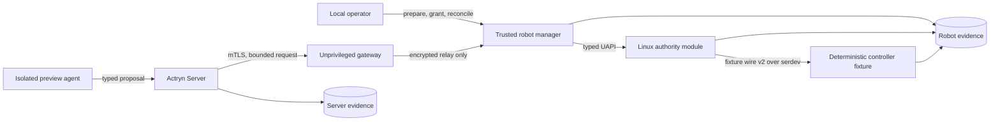

# Actryn

[](https://github.com/volnlabs/actryn/actions/workflows/checks.yml)
[](docs/superpowers/specs/actryn-v0.0.1.md)
[](LICENSE)

**A bounded execution path from an AI agent to a robot controller.**

Actryn runs an isolated agent on a server, accepts only a typed robot skill,
requires local authorization, and sends the resulting operation through a Linux
kernel authority gate. Operation identity, cancellation, recovery, resource
accounting, and evidence survive failures instead of being inferred from a lost
network reply.

> [!IMPORTANT]
> **v0.0.1 is a software-only developer preview qualified by the sole
> maintainer.** Independent installation and physical qualification have not
> been performed. The shipped target is a non-actuating QEMU fixture;
> `physical_acceptance=false` and `live_actuation=false`.

## What the preview demonstrates

```text
install signed roles
  -> run one isolated agent attempt
  -> produce a bounded wheel.index_step.v1 proposal
  -> review and authorize it locally
  -> execute through the kernel authority and controller fixture
  -> finish or interrupt
  -> reconcile retained state
  -> inspect and export evidence
```

The success path is only half of the contract. The preview also preserves
uncertain outcomes across crashes, cancels work before its first operation-ID
reply, rejects stale or replayed requests, prevents a second operation from
starting before reconciliation, and keeps unresolved external work charged.

## Architecture



The gateway forwards encrypted traffic but cannot open the authority device or
invent a principal. The trusted manager owns durable robot state. The kernel
module enforces owner identity, finite grants, operation lifetime, stale-request
rejection, revocation, and controller-session binding. The controller fixture
provides deterministic queues, delayed replies, interruption, and restart for
software qualification.

The kernel component is a narrow loadable module for the selected target, not a
Linux fork or a general agent runtime.

## v0.0.1 scope

| Component | Qualified preview boundary |
| --- | --- |
| **Actryn Server** | Debian 13.7 amd64 on Linux `6.12.111+deb13-amd64`; one resource-bounded OCI attempt, restricted artifact/model path, cleanup, diagnostics, and evidence export |
| **Actryn Robot** | Debian 13.7 arm64 QEMU guest on Linux `6.12.111+deb13-arm64`; one built-in `wheel.index_step.v1` skill, typed proposals, stable operation handles, cancellation, reconciliation, and recovery |
| **Kernel authority** | GPL-2.0-only C module with the fixture serdev backend, fixed UAPI, ownership and lifetime enforcement, revocation, stale-input rejection, and actual guest-kernel tests |
| **Controller fixture** | Non-actuating fixture-wire-v2 endpoint with command acceptance, queues, delayed replies, interruption, expiry, and restart behavior |
| **Developer surface** | Native `actryn` CLI, Python SDK, immutable signed role bundles, systemd services, and public verification receipts |

The signed manifests pin the exact target images, kernel/configuration hashes,
packages, binaries, protocols, and compatibility revisions. Source builds or
host CI passing do not make a different tuple compatible.

### Deliberately outside this preview

- Physical wheels, firmware, motor drivers, measured motion limits, and live
  actuation
- Independent installation by a second operator (the original A14 gate)
- General robot plugins, generated robot-local code, additional controllers,
  multi-robot coordination, or a custom scheduler/JIT
- Claims that a controller acknowledgement proves physical displacement

## Verify the qualified metadata

The repository contains the public release key, canonical Server and Robot
manifests, detached Ed25519 signatures, and bounded qualification receipts. The
large role payload archives are retained outside Git; their hashes are bound by
the signed manifests.

From the repository root:

```sh
python3 -B ci/signed_distribution.py \
  --require-signed \
  --require-qualified
```

A successful result reports:

```json
{
  "signed_distribution_verified": true,
  "release_qualified": true
}
```

This verifies the public metadata and final software-preview receipt. Custody
workstations can additionally stream the ignored raw evidence with
`--evidence-root .`. See the [host-check contract](ci/README.md) for the exact
difference between hosted verification and retained release evidence.

The final public records are:

- [software-preview qualification](docs/development/v0.0.1-release-qualification.json)
- [signed-distribution verification](docs/development/signed-distribution-verification.json)
- [off-host archive restore](docs/development/final-distribution-archive-restore.json)
- [public key and signed manifests](docs/development/v0.0.1-signed-metadata/README.md)

No tag or binary release publication is implied by these records.

## Build and test from source

The workspace pins Rust `1.92`; Python checks require Python 3.11 or newer. The
full prerequisite list and the limits of host-only testing are in
[ci/README.md](ci/README.md).

```sh
# Rust formatting, linting, unit/integration tests, and storage fault regression
python3 -B ci/check.py rust --output artifacts/ci/local-rust01

# Python SDK, packaging, service, and qualification-structure tests
python3 -B ci/check.py python --output artifacts/ci/local-python01

# Kernel host tests, wire checks, and diagnostic campaign validators
python3 -B ci/check.py kernel-host --output artifacts/ci/local-kernel01
```

Each output directory must be new. The runner records the source revision,
dirty state, commands, exit codes, timings, and logs. These jobs establish source
regression status; they do not reproduce the signed Debian guests, target kernel
campaigns, or physical behavior.

For a narrower crate-level loop:

```sh
cargo test --workspace --locked
PYTHONPATH=sdk/python python3 -B -m unittest discover -s sdk/python/tests -v
make -C kernel test
```

## Install and operate the preview

Installation requires the signed role candidate, the independently pinned
release public key fingerprint, and the exact supported Debian target tuple. A
source checkout does not contain the large `payload.tar` files and is not itself
an installable release bundle.

Use these guides in order:

1. [Verify, stage, activate, and bootstrap immutable bundles](packaging/release/README.md)
2. [Enroll, pair, authorize, execute, cancel, reconcile, and export with the CLI](apps/cli/README.md)
3. [Use the Python SDK from an installed Server role](sdk/python/README.md)
4. [Inspect the fixed preview-agent artifact and broker profiles](packaging/agent/README.md)

Installation and pairing never issue authority. Service activation starts in an
inhibited state. Every mutation is single-submission: after a transport loss,
inspect the retained handle instead of creating a replacement operation.

## Repository map

| Path | Purpose |
| --- | --- |
| [`apps/`](apps/) | CLI, Server broker/launcher, Robot manager, encrypted gateway, and preview agent |
| [`crates/`](crates/) | Portable reducer, RPC/wire types, fixture logic, and shared runtime components |
| [`kernel/`](kernel/) | Authority module, UAPI, serdev backend, selftests, KUnit, and diagnostic campaigns |
| [`packaging/`](packaging/) | Reproducible role bundles, installers, systemd/sysusers policy, and agent artifact tooling |
| [`sdk/python/`](sdk/python/) | Bounded Python client with explicit request handles and no mutation retries |
| [`schemas/`](schemas/) | Robot protobuf API and controller fixture-wire-v2 contract |
| [`targets/`](targets/) | Selected QEMU fixture profile and build inputs |
| [`ci/`](ci/) | Host checks and public qualification/signed-distribution validators |
| [`docs/`](docs/) | Architecture contracts, release evidence, research, reviews, and implementation history |

## Read next

- [v0.0.1 developer-preview specification](docs/superpowers/specs/actryn-v0.0.1.md)
- [System architecture and delivery gates](docs/superpowers/specs/architecture.md)
- [Kernel/controller contract](docs/architecture/kernel-controller-contract.md)
- [Platform/release contract](docs/architecture/platform-release-contract.md)
- [Solo-maintainer release handoff and evidence boundary](docs/development/solo-preview-handoff.md)
- [Complete architecture field guide](docs/actryn-architecture-guide.html)

Historical reviews retain the previous product name, **Voln**. Actryn is the
current product and repository name under VolnLabs.

## License

Original userspace code is licensed under [Apache-2.0](LICENSE). The Linux
authority module, kernel tests, and observer BPF code are licensed under
[GPL-2.0-only](LICENSES/GPL-2.0-only.txt), as identified by their source headers.
Third-party dependencies retain their own licenses; release bundles carry their
notices and the corresponding kernel source.
