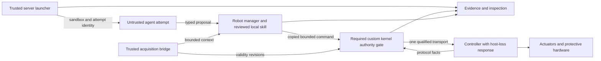

# VolnLabs independent architecture review

Historical review of the preserved pre-patch baseline. See the [remediation record](2026-10-13-review-remediation.md) for the current design changes and remaining validation gates.

Date: 2026-10-13. **Verdict: revise before freezing the production interfaces.** The architectural direction is worth pursuing, and a custom Linux kernel component remains a first-release requirement. The current design does not yet resolve several contracts that determine whether stale work can move hardware, interruption actually completes, or the retained evidence supports the report.

The previous pass completed a proposed architecture and selective source inspection. It did **not** independently review every project/paper. This pass supplies the independent challenge, per-reference dispositions and explicit source gaps. Every named project/platform/research family in the supplied brief is accounted for in the linked inventories, with aliases grouped transparently. “Accounted for” does not mean every implementation, paper appendix, dependency or physical claim has been validated.

## What was reviewed and how independent it was

The review target is the 425-line [system architecture](baseline/2026-10-13-volnlabs-system-architecture.md) and its [selective source review](2026-10-13-source-review-baseline.md). They remain unchanged so the reviewers' line references are stable. Snapshot SHA-256:

```text
architecture: a4e026097cf2fb5dc127dcd5b8af8f7c43d8e4cd9e6f63e97b63268e9e9de313
source review: 72837a0135cb6dbf35f4cb64c919e7e82ea60ed1758370bbca088a90064f1fd2
```

Three reviewers who did not author the design independently examined different parts of it. The original designer performed the platform audit and synthesized their findings; this is explicit rather than describing every paragraph as independently authored. These are separate agent reviews, not external customer, security-lab or physical-certification reviews.

| Review | Scope and useful result | Evidence limit |
|---|---|---|
| [Architecture attack](2026-10-13-architecture-attack.md) | Entire design; 13 findings with line references, counterexamples, minimal corrections and proof gates | Selected local kernel/Shrike source; no executed implementation |
| [Robot-project audit](2026-10-13-robot-project-audit.md) | Deployment, hardware/control frameworks, communication, governance, fallback, intervention and evaluation; 8 ranked findings | Primary docs plus selected pinned implementation files; no whole-project qualification |
| [Paper audit](2026-10-13-paper-audit.md) | All 15 research references; 7 architectural findings and per-item adoption tests | 11 selected full-text method/evaluation/limitation reads, one essay, UnifoLM docs, two conference abstracts; four selected-code inspections |
| [Server/platform audit](2026-10-13-server-platform-audit.md) | Isolation, enforcement, inference runtimes/models, monitoring, persistence, replay and test tools; 6 findings | Root-authored source refresh; mostly primary docs, with selected Actime/ActPlane/local source inspection |

Finding counts overlap; they are not 34 independent implementation bugs. Many are requirements the original document acknowledges but leaves without a chosen mechanism. A **design gate** must be resolved before implementing the affected production interface. A **qualification gate** needs measurement on a selected target. Bounded prototypes may investigate either without claiming release readiness.

## The decisions that must change

### 1. Specify revocation as an ordered operation, including bytes already in flight

Reserved queue capacity does not specify when revoke becomes effective. Nor does “finish, abort or resynchronize” select what happens when half a motor frame has already entered a UART buffer. A syscall returning that a request was accepted must differ from effective local revocation, downstream reconciliation and observed physical response.

The next design revision must choose urgent-event ordering, the exact invalidation point, timeout precedence and per-turn work bounds. It must also choose a recovery action for every partial-frame offset. Account for already accepted bytes and any old-frame effect; only the supported controller contract may close the handoff. See attack findings 1–2.

**Exit:** deterministic full-queue/timeout/revoke interleavings and every-byte-offset parser/TX cases; separately measured host closure, controller reconciliation and physical response. Queue boundedness alone provides no host scheduling deadline.

### 2. Make freshness cross the actual controller wire and reset boundary

The strongest source-level mismatch is in the proposed extraction: Shrike's handoff code limits identity uniqueness to its object lifetime and requires an inhibited drain/quiet protocol. Its ordinary motor setpoints carry a sequence and motor values, while handoff messages have session identity. A nonrepeating Linux epoch is insufficient unless the endpoint protocol carries/checks it or the reset/drain procedure excludes all old traffic. See attack finding 3 and the [local source references](2026-10-13-architecture-attack.md#3-high--nonrepeating-host-epochs-do-not-establish-controller-freshness-across-reboot).

**Required choice:** per-command endpoint session/boot identity with defined wrap behavior, or a verified inhibited reset/drain/quiet procedure. Do not copy a 200 ms quiet interval without proving its assumptions on Linux, the driver buffers and controller.

**Exit:** independently restart either peer, preserve bytes through reset, replay old commands/receipts and exhaust sequence identities. This is a design counterexample; no exploit or physical failure has been reproduced.

### 3. Select one executable behavior class and separate its lifetime from protection

An installed artifact could currently mean a server image, generated robot-local code or a trusted local skill configuration. That ambiguity changes the sandbox, state owner, update process and UAPI. The smallest recommended V1 class is **untrusted server agent → bounded proposal → reviewed robot-local skill**. If robot-local generated code is necessary, it requires a selected launcher and isolation contract before release scope is frozen.

Task grant loss must not kill a stabilizer needed to remain upright or hold a payload. Conversely, an independent stabilizer cannot become an ungoverned raw writer. A restrained wheel fixture can explicitly exclude active stabilization; that does not qualify humanoid balance or arm holding. Name the controller/protective behavior that survives complete host failure. See attack findings 4–5/7, platform S2 and robot findings 1–5.

**Exit:** process death/FD inheritance/unbind/PM tests; a complete artifact-to-process-to-instance-to-grant mapping; task-only revoke versus daemon/host/controller loss tests. Recovery actions such as homing or opening a gripper need their own installed authority because they can cause physical effects.

### 4. Define operations, samples and chunk commitment separately

One immutable operation digest cannot describe changing sample payloads without an additional identity rule. Specify operation, stream/chunk and sample identities; changed-payload duplicates; local target time/step; allowed order; cancel closure; and the already accepted prefix. A new chunk may replace only eligible uncommitted work. Policy state must use actual clamps/interventions/accepted work rather than assuming its predicted prefix occurred.

These semantics are needed even when RTC, Interlatent and learned hierarchical policies are deferred. Their implementations are not interchangeable, and RTC does not convert arbitrary hosted tool calls into a streaming control policy. See attack finding 6 and paper findings 2–3.

**Exit:** late/reordered chunks, duplicate sequence with changed values, cancellation within a live grant, elapsed samples, loss of sample traffic and replay after rearm. No held target may outlive its declared endpoint validity merely because the producer stopped.

### 5. Keep local validity, model lineage and physical truth distinct

A fresh observation record is not proof that the model used it. A tracker timestamp is not fresh measurement support while the object remains occluded. Numeric/joint/frame limits are not a general collision or contact verifier. An inferred “planner failure” is not independently established causality.

The next revision needs ordered calibration/clock-revision invalidation, bounded acquisition-age uncertainty, operation-correlated inference/progress context, per-skill geometric/support preconditions, and separate fields for observed facts versus learned diagnoses. Bridge records can establish association under their declared trust model; a compromised server can fabricate its own lineage. See attack finding 8, platform S3 and paper findings 1/3–5.

**Exit:** calibration changes between admission and dispatch, stale response relabeling, unsupported occlusion, individually legal but conflicting action geometry, and interventions that invalidate learned failure labels. Kernel admission should state exactly which fixed predicates passed.

### 6. Give the server and recorder concrete acceptance contracts

The server needs an installed-policy coverage table, attribution before first execution and a real source for each claimed denial. ActPlane engine support must not be inferred for Actime's narrower integration. Telemetry loss and enforcement loss require different outcomes.

The recorder needs separate read/backlog/durable watermarks and a bounded persistence-loss policy that also applies to existing streams. Each attempt needs a capture manifest and replay eligibility result. Metadata-only capture cannot promise image/model-context replay. Recorded-output playback is useful; reproducible fresh inference is a different experiment. See attack findings 9–10 and platform S1/S5.

**Exit:** enforcement attach failure, false policy attribution from ordinary errors, immediate descendants, reader-alive/writer-stalled, ENOSPC, evidence overflow, crash at persistence boundaries and partial export. Preserve trusted source identity and visible gaps throughout.

### 7. Freeze a supported release tuple, not three mutually moving repositories

Keep the proposed `voln`, `voln-linux`, `voln-targets` split for now: their build, privilege and qualification responsibilities differ. Add a promotion record that pins userspace, schema/UAPI, kernel/configuration/module, vectors, target config and firmware by immutable identity, with the conformance evidence for that tuple. Test against those identities, not sibling `main` branches. Server releases need independent promotion eligibility so a security fix does not wait for unavailable robot hardware.

Enrollment, credential rotation/revocation and lost-key recovery also need a chosen bootstrap protocol; reconnect/re-enrollment must never imply rearm. A signed artifact and a successful package install establish neither compatibility nor current physical authority. See attack finding 12 and platform S4.

**Exit:** reconstruct a release from its manifest, reject an incompatible tuple, stage a failed trusted-stack update while inhibited, recover without restoring authority, and complete a server-only release while robot qualification remains pending.

## Recommended system after those corrections

The broad ownership arrangement survives the review. The diagram shows responsibilities, not a claim of implemented components or attested remote model execution.



| Distribution unit | Keep | Tighten before freezing |
|---|---|---|
| `voln` | CLI, restricted launcher, server reports, robot manager, Python client, schema, evidence/export, portable semantic model | One supported behavior class and sandbox backend; concrete identity/enrollment/denial/capture contracts; no collection of overlapping agent runtimes |
| `voln-linux` | Mandatory custom endpoint ownership, fixed typed admission, generation/expiry enforcement, dispatch serialization and authoritative boundary events | Exact target kernel/lifetime/PM mechanism; minimal protocol state needed to validate real handoff facts. C versus kernel Rust and UART backend remain target-support choices, not settled by the development checkout |
| `voln-targets` | Exact hardware/firmware/configuration profiles, route inventories, tests and raw qualification evidence | Controller-session protocol, independent host-loss mechanism and supported update tuple; no claimed universal adapter |
| Release manifest | One CLI/schema compatibility story with separately promotable server and robot profiles | Immutable component digests and explicit supported/unsupported combinations; successful source builds alone cannot promote physical support |

A custom module satisfies the user's requirement only when it owns a necessary enforceable boundary. A tracing-only module would not satisfy this design. Conversely, required kernel participation does not justify putting inference, arbitrary skill execution, cryptographic package parsing, database I/O or a general monitor language in the kernel. Shrike/UART is a plausible engineering fixture candidate; compare it against one actual alternative before declaring it the supported customer endpoint.

The adoption rule should become **standard facility, then supported public API, then narrow adapter, then source extraction or fork only with a demonstrated semantic need**. Tailoring a dependency means configuring its privileges and adapting its interface to our contract; it does not require rewriting all of it. AxiomOS state machines/tests are strong extraction candidates because platform mechanisms must change. Ordinary libraries and runtimes should not be copied merely to claim ownership.

## Coverage of all 40 requested problems

This maps each original problem to the review's material decision. “Retain” means the principle survives; it does not mean implemented or physically validated. A = architecture-attack finding; R = robot-project finding; P = paper finding; S = server-platform finding.

| # | Problem | Review disposition / required closure |
|---|---|---|
| 1 | Named hardware | Open: compare two actual target candidates; full protective chain; R1/A11 |
| 2 | Reproducible installation | Retain existing Linux; compare simple packaging/Wendy; R5/A12 |
| 3 | Device versus motion identity | Revise enrollment/revocation/recovery protocol; S4 |
| 4 | Adapter reuse | Require route and lifecycle ownership map; R3/R5 |
| 5 | Trusted updates | Freeze release tuple and inhibited recovery; A12/S4 |
| 6 | Agent isolation | Select concrete execution class/backend/profile; A7/S2 |
| 7 | Denial versus observation | Install and test per-rule coverage; A10/S1 |
| 8 | Trusted attribution | Launch ordering and lifetime binding; A10/S1 |
| 9 | Diagnosis | Select a useful failure story and evidence sources; A13/S1/S6 |
| 10 | Resource interference | Retain bounded paths; measure exact workload and persistence pressure; A1/A9 |
| 11 | Inference placement | Pin one actual runtime/model; hosted Astra identity unresolved; platform inventory |
| 12 | Robot tool vocabulary | Restrict framework tools and define executable artifact; A7/R3/P1 |
| 13 | Observation age | Ordered revisions and truthful request lineage; A8/S3 |
| 14 | Perception/representation | Measurement support, calibration, masks and units; P1/P4 |
| 15 | Failure categories | Keep learned attribution distinct from observed faults; P5 |
| 16 | Remote/local timing | Retain local execution; select surviving stabilizer/fallback; A5 |
| 17 | Inference contention | Defer optimization until measured; separate throughput from feedback rate; P6/OxyGen row |
| 18 | Asynchronous chunks | Define sample identities and commitment frontier now; A6/P2 |
| 19 | Local lifecycle/runtime | One lifecycle/scheduler owner per role; R5 |
| 20 | Communication | Delivery does not grant authority; explicit queue/lifetime policy; robot transport rows |
| 21 | Effective owner | Retain grants; close owner death, PM and task/protective authority; A4/A5 |
| 22 | Physical suitability | Bound admission claim; choose skill-specific geometry/contact validation; P1/P4 |
| 23 | Bypass | Inventory actual endpoint routes; framework writers must be replaced; R3/A11 |
| 24 | Artifact/instance/grant | Retain separation, choose actual execution mapping; A7/S2 |
| 25 | Replacement | Retain fresh state and guarded publication; prove revoke/receipt ordering; A1/A4 |
| 26 | Already transmitted work | Select every-offset recovery and downstream completion; A2/A3 |
| 27 | Retries/restart/restore | Preserve unknown outcomes; add wire epochs and stream identity; A3/A6 |
| 28 | Programmable guards | Defer; fixed kernel predicates first; platform bpftime/llvmbpf/monitor rows |
| 29 | Agent loss versus stabilization | Select independent continuation/fallback path or exclude active stabilization; A5 |
| 30 | Whole-host loss | Controller/electrical response; software watchdog is insufficient; R1/R4 |
| 31 | Human takeover | Same grant/queue rules and measured completion; A1/A2/R3 |
| 32 | Correlated evidence | Preserve origin, trust level, clocks and gaps; S3/S5 |
| 33 | Replay | Capture eligibility; playback isolated from live authority; S5 |
| 34 | Episode labeling | Preserve proposal/clamp/intervention/unknown separately; P5/R8 |
| 35 | Rare interleavings | Retain deterministic fixtures; add identified counterexamples; A1–A10 |
| 36 | Physical qualification | Retain separate software/fixture/robot evidence; R1/A11 |
| 37 | Developer workflow | Prove second-operator install/recover/diagnose, not CLI existence; A13 |
| 38 | Dependencies and terms | Per-file/runtime/model inventory, public APIs before forks; R6/S6/paper license section |
| 39 | Repeatable sale | Name two useful product stories and one buyer workflow; A13 |
| 40 | Differentiation | Compare against governed userspace systems; R7/A11 |

## Source gaps that remain explicit

- **PACE and H-GenPO:** exact primary conference identities and abstracts obtained; full OpenReview papers/API were inaccessible. Detailed adoption remains deferred. This updates the earlier announcement-only status without pretending the missing full texts were reviewed.
- **UnifoLM-WLA:** implementation/specification reference here, not an independently reviewed full technical paper. **LessMimic:** inspected repository still promises code release. **GTP-FA and vision-locomotion:** no selected deployment implementation audited.
- **EMOS and HORUS:** the robot audit identifies the specific ecosystems assumed; similarly named unrelated projects were not silently substituted. **Astra:** hosted provider/model identity remains unspecified.
- **GPT-Policy:** inspected license text grants no selected redistribution/commercial license; use interface lessons while source reuse remains unresolved. Other selected binaries/models need their own complete terms/dependency inventory. Current files and docs can differ from the earlier proposal.
- **All projects:** this was selective source and primary-document review. No dependency combination, model performance, timing, physical safety, security certification or customer demand has been established by the review.

The egocentric-data conclusion survives: synchronized observations become useful experimental evidence only with actual execution, intervention and gap history. Neither the reviewed literature nor an exclusivity slogan establishes a data-sourcing advantage.

## Order of work after this review

1. Close the executable-artifact, target, wire-session, revoke/partial-frame and lifetime contracts first. Give each one a state/event table, invalid cases and quantitative fields that must be measured; do not bury choices in implementation defaults.
2. In parallel, build the independent server acceptance slice around one real diagnosis question and the selected coverage table. It does not depend on a physical robot.
3. Exercise the same kernel/manager/protocol contracts against deterministic controller fixtures, including every counterexample above. Keep the userspace comparison competent and use the same controller semantics.
4. Qualify the chosen restrained physical chain, then the named robot workflow. Promote only the exact measured tuple; repeat installation and recovery with a second operator/device before treating it as a repeatable product.

Document validation passed: 30 local links across the five review documents and README resolve; code fences are balanced; the problem matrix contains exactly IDs 1–40 and the paper matrix exactly IDs 1–15. A 93-name/alias checklist found no omitted name from the supplied project/platform/research inventory; that check confirms coverage only, not review depth. Both original file hashes above remain unchanged. The workspace root is not a usable Git repository, so no commit/diff status is claimed.

This review is complete as a documented independent challenge with reference coverage. The architecture needs revision before production interfaces are frozen. No implementation, build, model experiment or physical qualification was performed in this review, and the original design files have deliberately not been silently rewritten.
