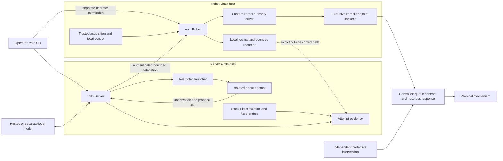
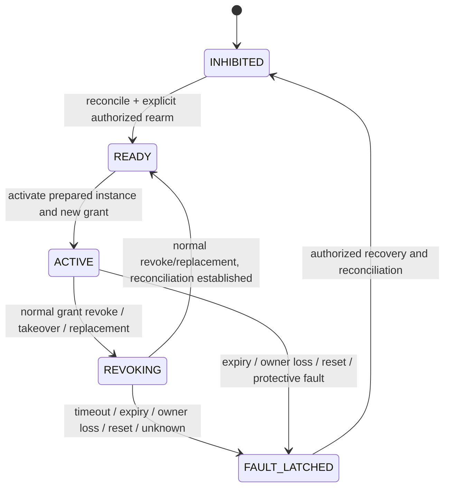

# VolnLabs system architecture and project distribution

Date: 2026-10-13. Revision: **review-remediated design**, not an implemented or qualified system. Names, commands and repository trees below are proposed interfaces. No hardware configuration, commercial dependency, performance bound or customer demand is established by this document.

This revision incorporates the [independent review](../../reviews/2026-10-13-independent-architecture-review.md). The normative details are in the [kernel/controller contract](../../architecture/kernel-controller-contract.md) and [platform/release contract](../../architecture/platform-release-contract.md); this document defines their scope and composition. The [remediation record](../../reviews/2026-10-13-review-remediation.md) maps every finding to its change or remaining evidence gate. Byte-identical pre-patch snapshots preserve the review's line references.

## 1. Recommendation and design brief

Build **Voln Server** and **Voln Robot** around one operator CLI and a shared contract. Keep userspace cohesive, release a small custom Linux authority component separately, and distribute hardware support as versioned target packages. Keep AxiomOS as a source of implementation experience and regression cases; extract its authority and lifecycle logic without bringing its boot, memory, filesystem or scheduler stack into the product.

The product is a repeatable operation: install, pair, observe, propose, admit, execute locally, interrupt, reconcile, rearm, inspect. Server-only installations must also be useful: a team can run an isolated agent attempt and explain its Linux resource consumption and denied operations without owning a robot.

User requirements carried into this design:

- Execution and authority remain local to the robot; model inference may be remote.
- Generated applications cannot obtain raw actuator access or enlarge their own grant.
- Installation works on an existing supported Linux distribution.
- Replacement, retries, crashes, controller queues and physical uncertainty are explicit parts of the contract.
- Upstream projects are assessed for a specific capability; adopting an entire framework is not the default.
- The first supported physical configuration and recurring customer workflow remain narrow.

Working assumptions: one commercial robot-learning/agent team as the buyer hypothesis; one operator-managed site; one wheel-pair ownership group; a restrained fixture before an assembled rover; a hosted model for the first demonstration. These are recommended starting choices, not confirmed equipment or measured inference suitability. The specific hosted provider/model remains unselected; “Astra” is not an API or model-version specification. TurtleBot3/OpenCR is a comparison candidate, not selected equipment.

**Selected V1 execution class:** untrusted Python/native agent code runs in a server OCI sandbox. It invokes reviewed, release-built native skills in `voln-robotd` using bounded typed proposals. A robot behavior artifact is immutable skill configuration referencing one of those fixed skill IDs, not uploaded executable code. Instance state belongs to `voln-robotd` and resets on activation. Generated robot-local code, dynamic plugins, live model/skill weight replacement and physical checkpoint restore are unsupported in V1.

The initial restrained-wheel profile requires no active balance or load holding. Its declared host-loss response is controller-side torque disable through the named electrical mechanism; braking distance and residual motion must be measured. This does not qualify an arm, balancing robot or humanoid. A later active-stabilization profile must separately assign surviving control/protective authority and qualify its transitions.

**Confirmed user decision:** a custom Linux kernel component is mandatory in the first release. The selected mechanism is a small authority driver and one exclusive controller transport backend. It governs ownership, fixed admission, dispatch and the protocol facts needed to validate handoff; it does not run arbitrary agent code. The historical direction is recorded in the [context brief](../../../../docs/proposals/axiomos-context-2026-10-11.md). Kernel inclusion is a product requirement, while superiority over the userspace baseline remains a hypothesis to measure.

### Alternatives considered

| Approach | What it buys | Cost / reason for decision |
|---|---|---|
| **Selected: our kernel authority component plus Linux userspace services** | One kernel-owned publication/dispatch boundary, existing Linux installation, separable server product | Requires exact kernel builds and a narrow supported transport; privileged Linux and downstream controller remain trusted |
| Userspace authority gateway on stock Linux | Smaller maintenance surface and a strong comparison baseline | Does not satisfy the required kernel component; retain as a measured baseline and reference model |
| Build a distribution around a complete upstream robotics/agent platform | Faster access to that platform's integrated features | Imports its authority, lifecycle, dependency and update assumptions; adapt only if its semantics fit better than our small core |

Do not fork a dependency merely to call it ours. Our ownership comes from the interfaces, integration, guarantees, support and evidence we maintain. A proven library may remain an ordinary pinned dependency; source extraction needs an explicit advantage over using its public API.

## 2. Product and repository boundaries

Start with **three product repositories**, plus the existing research/reference repositories. Kernel and firmware qualification have different compatibility obligations from userspace. Processes and libraries do not each need their own repository.

| Repository | Contents | Release / owner responsibility |
|---|---|---|
| `volnlabs/voln` | CLI, server, robot manager, Linux probes, RPC contracts, Python SDK, userspace reference model, packaging and cross-boundary conformance tests | One tested userspace release; runtime/platform owner maintains client compatibility and security fixes |
| `volnlabs/voln-linux` | Small authority driver, first kernel endpoint backend, versioned UAPI, kernel selftests, build/configuration and packaging metadata | Kernel owner maintains exact supported bases, synchronization, ABI, module provenance and security fixes |
| `volnlabs/voln-targets` | Exact target manifests, electrical/setup documents, calibration procedure, controller firmware we actually maintain, target-specific fault/physical qualification procedures | Independently versioned target package; endpoint owner signs off supported combinations and changed physical claims |
| Existing `axiomos` | Bare-metal research and source from which tested state machines are extracted | Separate research release; not a transitive production dependency |
| Existing/reference `linux` and `ref/*` | Source inspection and bounded experiments | Not shipped, built or updated implicitly by product builds |

Do not create a server kernel fork and a robot kernel fork. `voln-linux` is initially a small source repository for a driver built against named distribution kernels, not a copy of the entire Linux tree. Prefer a loadable module using exported interfaces; maintain a minimal patch series only where an exact supported target needs it. The server uses stock kernel isolation plus our packaged BPF programs; the robot installs the authority driver. Every production kernel build remains pinned and qualified.

Keep customer recordings, credentials and site-specific evidence outside source repositories. Target packages contain public fixtures and evidence manifests; private raw evidence belongs in access-controlled artifact storage. A qualification statement names its exact software, target and evidence digests.

Proposed `voln` layout (logical boundaries, not a requirement to create one crate per directory):

```text
voln/
  apps/
    cli/                    # voln
    server/                 # voln-serverd
    robot/                  # voln-robotd: preparation, RPC, kernel client
    host/                   # restricted launch helper and observer
  crates/
    contracts/              # stable identity, messages, outcomes; no device I/O
    axiom-model/            # extracted semantic model and userspace baseline
    fixture-wire/           # new session-bound v2 codec/vectors; no implicit v1 compatibility
  adapters/
    kernel/                 # checked client for the authority UAPI
    ros2/                   # added only for a selected ROS controller profile
  sdk/python/               # generated transport types + small ergonomic client
  schemas/                  # versioned RPC and event definitions
  bpf/                      # reviewed fixed probes and optional denial programs
  packaging/{deb,systemd}/
  tests/{contract,fault,compatibility}/
  docs/{architecture,operator,integrator}/
  third_party/              # notices, extraction provenance and patch records
```

Proposed `voln-targets` layout:

```text
voln-targets/
  targets/<target-id>/<revision>/
    manifest.yaml           # hardware + complete compatible software tuple
    command-paths.md         # every route to the protected outputs
    endpoint-contract.yaml  # machine-readable supported subset
    wiring/                 # actual protective mechanisms and instruments
    qualification/          # procedures, fixtures, acceptance definitions
  firmware/shrike/           # only if we own firmware for that target
  evidence-manifests/        # hashes/references; no implied physical PASS
```

Dependency direction: RPC contracts → userspace services/SDK; versioned kernel UAPI → checked userspace kernel client. The kernel driver has no dependency on Python, RPC libraries or daemon internals. Target packages pin product, kernel component and firmware versions; the product does not import arbitrary scripts from target manifests. Share a portable wire library with firmware only if its actual allocation/platform constraints fit; otherwise use golden protocol vectors across implementations.

Proposed `voln-linux` layout:

```text
voln-linux/
  include/uapi/linux/voln.h  # canonical versioned kernel interface
  drivers/voln/
    authority.c             # ownership, publication, queues, revocation
    limits.c                # fixed first-endpoint validation
    fixture_serdev.c         # proposed UART writer for the new fixture wire contract
  tests/{kunit,selftests}/
  compatibility/            # golden traces shared with the userspace model
  packaging/                # exact kernel tuples, module signing, build metadata
  patches/                  # only when a supported base requires a patch
```

Keep RPC schemas, SDK and daemons together so API changes are reviewed together. Kernel UAPI is canonical in `voln-linux`; userspace consumes its versioned header/bindings and CI detects drift. Wire vectors are immutable shared artifacts, not a circular source dependency. A promotion manifest records exact source/binary/vector/configuration/evidence digests across all three repositories. Consumers test those digests, never a sibling moving branch. Server and robot profiles have independent promotion records under the shared compatibility policy; a server security fix need not wait for physical robot qualification or upgrade an already qualified robot tuple. Kernel-internal Linux APIs are not assumed stable between builds.

## 3. Deployment topology and trust



First demonstration topology: a server laptop or separate supported Linux host, robot-local computer, and the selected controller/fixture. A second Pi can serve as the server if its measured workload fits; exactly two Pis is not a product requirement. Hosted inference leaves agent orchestration local but **does not make inference local**. No hosted model is required for cancellation, revocation, controller fallback or rearm checks.

Permit a single-machine developer/simulator profile, with no live actuator device mappings. Co-locating inference and motion on a physical robot is a separate resource-interference qualification, not a packaging checkbox. Do not initially support mutually hostile tenants on a robot; each robot runtime owns one site configuration and explicit coupled actuator groups.

### Processes and privileges

| Process / component | Responsibility | Authority |
|---|---|---|
| `voln` | Human/automation client, diagnosis and offline evidence inspection | User credential scope only; no hidden motion or deployment privilege |
| `voln-serverd` | Attempt orchestration, model/tool correlation, scoped robot client, evidence index | No raw devices, BPF loading or unrestricted container-engine socket |
| Restricted host helper | Server launch or robot operator administration, in separately scoped service roles | Protected authenticated local interface; caller-to-attempt/policy authorization; no caller-selected ownership, arbitrary descriptors, host command or credential paths |
| `voln-observer` | Attach/read approved Linux probes; emit attribution and loss records | Profile-specific loading privileges; agent cannot submit BPF or access writable maps |
| Agent attempt | Run Python/native tools/model client | Its sandbox and bounded proposal channel only |
| `voln-robotd` | Robot RPC, authentication, skill configuration preparation, fresh skill-instance state, bounded native skills, durable intents, kernel requests, evidence export | Runtime kernel handle within installed ceilings; no raw controller access, arbitrary code loader or ability to forge a kernel handoff receipt |
| `voln_authority.ko` + selected backend | Sole effective ownership, grant generations, fixed validation, publication, transmit queue and controller protocol | Kernel-resident final host dispatch boundary; direct controller binding excludes normal userspace writers |
| Sensor/control component | Produce qualified observations or execute a local policy | Narrow read/data interfaces; any command output still traverses the gate |
| Controller / protective equipment | Declared downstream execution, expiry and host-loss behavior | Independent of server and host application progress where the profile requires it |

The robot daemon handles management, preparation and persistence in userspace; it does not own a competing grant table. The kernel owns the effective grant and serialized dispatch state. A selected kernel backend binds the first controller transport. A future vendor/ROS worker can only offer the same enforcement claim if its path passes a suitable kernel endpoint integration; otherwise it is a separately labelled userspace-adapter profile, outside the first kernel-enforced motion claim. A worker holding raw actuator access remains trusted, even in another process.

The V1 threat model includes hostile unprivileged agents, delayed/replayed requests and component crashes. It trusts the host kernel, administrator, launcher, authority daemon, adapter, controller and required sensors. A kernel extension would not by itself protect against a compromised kernel or root administrator. A later hostile-host profile needs an independent authenticated enforcing controller/domain with suitable observation provenance; do not sell it as an automatic benefit of eBPF.

Lifecycle ownership is singular: the host helper owns sandbox start/cleanup; `voln-robotd` owns skill preparation/state and persistence; the kernel owns effective grants and host dispatch; the controller owns its command-deadline response; the operator owns rearm and trusted-stack promotion. Deployment tools may install but cannot activate. Framework self-healing, ROS spawners, teleoperators, homing/reset routines and vendor interfaces must either submit through the same protected path or remain outside supported integration. Start framework hardware inactive, disable automatic authority restoration, and use one selected local scheduler. A second process watchdog is only application-health evidence, not whole-host protection.

## 4. A small kernel authority component, not a new operating system

Use a supported distribution kernel, systemd and cgroup v2. Start with a single qualified distribution family and exact server/robot kernel configurations; different board kernels are acceptable. First package targets are Linux x86-64 server and AArch64 robot, subject to target preflight. Kernel/configuration version strings are filled by qualification, not invented in this design.

| Concern | Initial mechanism | Boundary / failure rule |
|---|---|---|
| Files, credentials, processes, devices | Namespaces, mount allowlist, UID separation, dropped capabilities, seccomp, device policy | Verify the installed policy before starting untrusted code; deny raw controller, GPIO, bus, runtime socket and inherited handles |
| CPU, memory, I/O, task counts | cgroup v2 profiles; bounded application queues | Constrains consumption; does not prove robot deadlines |
| Server network access | No external agent network; dedicated namespace and scoped local broker channel | Broker owns allowed model/tool egress and credentials; target/site network policy separately closes routes from other hosts |
| Attribution | Trusted launcher records attempt before execution; cgroup/process lifecycle tracking | Never trust an agent-provided PID, cgroup or trace ID as authority |
| Required host denial | Existing kernel mechanisms; selected supported BPF LSM hooks only where needed | Attach/verification failure prevents that policy-dependent workload from starting |
| Diagnostic visibility | Counters/pressure first, then a small libbpf CO-RE probe set | Missing probes or dropped records mark coverage incomplete; no silent prevention claim |
| Typed motion limits, ownership, stale requests | Custom `voln_authority` driver at its supported endpoint dispatch boundary | Generic BPF hooks do not supply these semantics; no coverage claim for unrelated drivers |
| Host freeze / loss of power | Named controller/protective mechanism | Cannot depend on another process on the same frozen Linux host |

The kernel's [cgroup documentation](https://docs.kernel.org/admin-guide/cgroup-v2.html), [BPF LSM documentation](https://docs.kernel.org/bpf/prog_lsm.html) and [libbpf overview](https://docs.kernel.org/bpf/libbpf/libbpf_overview.html) support the separation between resource/access mechanisms and observation. CO-RE reduces dependence on kernel structure layouts; it does not guarantee available hooks or semantic compatibility.

Ship `bpf/` objects and a feature manifest as ordinary product artifacts. Fixed reviewed C BPF programs with a libbpf-based Rust userspace loader are the initial observation direction. Required denial links/policies outlive the diagnostic reader through protected ownership/pinning. Loss of required enforcement blocks new launches and applies the declared quarantine/termination policy to affected attempts; it cannot undo an earlier effect. Reader loss marks evidence incomplete and never relaxes denial. Each product profile identifies its required enforcement and denied-operation reporting sources and versions.

### Kernel responsibilities and UAPI

The first driver provides a **fixed typed command class for one wheel-pair/fixture endpoint**, not a universal robotics syscall. It owns endpoint state, immutable owner-policy ceilings, active instance/grant generation, robot-local expiry, the bounded queue, final validation, revocation, controller session/barrier state and the authoritative event sequence. Only controller facts parsed by its backend can complete handoff. It must not accept a userspace `safe=true` assertion as that fact.

Use a small character-device UAPI with separate administrator, runtime, acquisition and read-only event rights. Operations cover capability discovery, inhibited configuration, owner/instance registration, pending grants, prepare/activate, parent-operation/sample submission, operation cancel, grant revoke, query, context-revision invalidation and rearm. Exact struct layout is versioned in `voln-linux`; the [kernel contract](../../architecture/kernel-controller-contract.md) fixes semantics first. Operator configuration/rearm require the separate admin role; runtime requests cannot widen ceilings or clear stop latches. A passed FD does not transfer session ownership. Remote identity is authenticated by the trusted robot manager, not discovered by the kernel from a claimed model hash.

The admin role creates the pending grant under its installed policy. Runtime `ACTIVATE` and `SUBMIT` only consume that operator-authorized grant; they cannot mint or enlarge authority, even below global ceilings. The grant binds the permitted principal/instance, group, operation class, duration and limits. Normal replacement needs an authorized candidate grant in addition to a successful handoff.

Use fixed-width fields, explicit lengths/versions, initialized padding, checked arithmetic and bounded copies; no userspace pointers survive a call, no borrowed userspace memory drives output, and no kernel pointers escape in events. Unknown mandatory operations/features fail. Register the initial thread-group leader's kernel lifetime identity, retaining references rather than a numeric PID alone. Recheck it before dispatch and on the periodic owner check; leader exit conservatively ends the session even if other threads retain descriptors. Fork/FD transfer does not transfer ownership. Death detection is not instantaneous: finite local/controller deadlines cover delayed detection or a stalled daemon. The selected kernel's reference/exit/exec checks and export availability must pass the build/lifetime gate. Module reload and reconnect require a new runtime and wire session; no last-FD-close-only lifetime rule is allowed.

### First enforceable transport

The engineering candidate is a **dedicated UART bound through Linux serdev to a custom fixture backend**. Production endpoint selection follows the two-candidate comparison in §7. This is not confirmation of available Pi pins, wiring or deployed firmware. Successful binding must exclude a normal writable TTY; the target also disables competing console/debug/boot-time use and audits pinmux, raw MMIO, debug/flashing and alternate controller routes. A binding failure keeps motion inhibited even if Linux exposes a fallback TTY. USB serial requires a separately designed backend.

All first-profile output writes originate in that backend. The enforceable boundary is **acceptance into the underlying UART driver's buffer**, not the final physical bit. Serialize each nonblocking accepted prefix and effective revocation with one authority lock. The chosen recovery rule permits finishing only the one already-started immutable old frame, under a bounded recovery deadline, before the inhibit/barrier. Drop all wholly unsent old frames. Its fixed original deadline and residual effect remain visible; it receives no refreshed authority. If completion/barrier fails, latch the fault and rely on controller expiry. Already buffered bytes cannot be retracted. Flush/drain alone never proves handoff.

**New wire contract, not existing Shrike compatibility:** every effect-bearing frame carries controller boot identity, fresh negotiated session, grant/operation/sample identity and an absolute controller deadline derived conservatively from the clock mapping. Delayed receipt cannot restart a TTL. The session/reboot, sequence exhaustion, controller parsing and barrier rules are fixed in the kernel/controller contract. Existing Shrike framing/state machines supply lessons and regression cases; their current motor frames and quiet-period assumptions do not implement this v2 protocol. A legacy firmware handshake fails preflight.

Use Rust for userspace and the semantic reference model. **C is the default kernel implementation candidate**, with support frozen only after an exact-target C-versus-kernel-Rust API/build comparison (§7). The inspected development tree contains Rust serdev support; availability on the production kernel remains a separate fact. Carry golden frame vectors, event/interleaving traces and independent expected outcomes across implementations. Never treat `no_std` or matching happy-path vectors as a synchronization/equivalence proof.

One authority lock orders all eligibility/publication and byte-acceptance mutations. A bounded worker executes ordinary queued transitions. An authorized cancel/revoke closes eligibility directly under that lock, outside the ordinary FIFO, before reporting local effectiveness; it wakes the worker for downstream recovery. Callbacks only capture bounded input/schedule work. Absolute deadlines are checked at the actual transition, so a captured-but-late receipt cannot win after timeout. No filesystem/network/model work or blocking controller wait occurs under the lock. The kernel contract specifies lock order, detached refcounted lifetime, callback/work cancellation and runtime-PM rules; exact implementation/build/race tests remain mandatory. Independent controller expiry covers host progress loss. The [source review](../../research/2026-10-13-source-review.md) records inspected API limits.

### What does not enter the kernel

Python, LLM inference, perception, motion planning, arbitrary policy graphs, artifact downloads/signature parsing and database writes stay in userspace. The kernel trusts its authorized manager's registration of executable provenance; this is weaker than verifying and executing the behavior bytecode itself in AxiomOS. It still independently enforces the installed command envelope, generations and endpoint protocol. The first release makes no claim that it runs AxiomOS managed programs or preserves their resource accounting.

No new JIT, scheduler, universal protocol parser or custom BPF verifier is selected. V1 fixed predicates cover numeric/identity/freshness limits. Replaceable admission predicates are a later bounded extension with a separately specified hook/context and verifier; they cannot widen fixed ceilings, alter owner transitions or clear latches. The custom driver is meaningful even without programmable predicates.

Measure the kernel component against the competent userspace baseline on the same endpoint. Its proposed benefit is enforceable single ownership at the supported host transport and a kernel-resident lifecycle when a userspace client misbehaves or exits. Kernel placement alone does not prove improved latency, resistance to kernel compromise, or physical safety.

## 5. The independent server product

Choose one initial sandbox backend: **OCI containers through containerd**, mediated by the restricted launcher. Reuse the runtime, not its unrestricted management API. A microVM backend is a later decision for a stronger stated threat model; Wasm is a different workload class. Wendy must not create a second independent sandbox lifecycle if its deployment integration is adopted.

The launcher creates `tenant → job → attempt → sandbox` records, allocates the cgroup and policy, prepares the workload without running application code, registers attribution and checks required enforcement, then releases execution. If the chosen runtime cannot provide that ordering, the launch integration fails acceptance. Fork/exec descendants inherit the attempt association; migration outside the designated cgroup is denied. Process identity includes host boot/lifetime information, not PID alone. Cgroup IDs and paths are also scoped to their lifetime. Cleanup includes descendants and credential revocation.

Start with process lifecycle, CPU/memory/pressure, I/O and network metadata. Correlate explicit model and tool spans through our client/broker. Add scheduling/page-fault probes only to answer a specific diagnosis question. Shared inference workers retain explicit request spans; a host cgroup cannot attribute every shared GPU operation to an individual request. A microVM appears as host VM activity unless an independently trusted guest collector supplies finer evidence.

Expose a report such as: attempt X exceeded its memory budget; subprocess Y made a failed device-open request; the broker denied a named method under rule Q; inference request Z overlapped I/O pressure. Preserve unknowns, probe loss and clock uncertainty. Do not infer plaintext model activity from encrypted sockets or equate network events with completed tool effects.

The [platform contract](../../architecture/platform-release-contract.md) selects the launch order and a policy coverage table. Reports distinguish `policy_denied` from `access_failed` and `coverage_unavailable`: an `EACCES`/`EPERM` syscall result alone does not identify which policy caused it. The initial demonstrable attributed denial is the scoped broker's rejected method/resource request; stock OS failures retain the narrower label unless the selected enforcement source supplies a matching fact. ActPlane/Actime remain optional and must qualify the actual integration path; a language feature or post-event kill is not inherited pre-effect blocking.

Provider credentials belong to the scoped broker; the agent receives only its attempt-bound channel. Do not mount site credentials or expose robot administrator keys. Default evidence stores metadata, not full prompts, images or secret-bearing payloads. Content capture is an explicit site policy. Each attempt declares capture requirements and playback eligibility; the full observation/model-output demonstration requires that capture profile to be enabled (§8).

A server-only release exits when isolation, attribution, denied-operation reporting, resource-pressure diagnosis, cleanup and evidence export work without a robot. It need not wait for motion qualification.

## 6. The robot execution contract

### Objects, identity and API

| Object | Meaning |
|---|---|
| Agent artifact | Immutable server OCI image/manifest digest; installation grants no authority |
| Skill artifact | Immutable configuration naming a release-built local skill, compatible profile, bounded arguments and versions; no V1 uploaded code |
| Instance | Fresh local skill state in `voln-robotd`, bound to one authenticated server attempt and prepared artifact |
| Owner policy | Operator-installed immutable revision of the allowed envelope and recovery conditions |
| Grant | Robot-issued, principal/instance/group-scoped permission with local expiry and generation |
| Operation | Stable externally meaningful requested effect, with digest and durable identity |
| Proposal | Immutable parent request referencing grant, skill/context and observations; child samples have separate identities/digests |
| Observation record | Robot-retained provenance, acquisition/receipt times, calibration and validity |
| Outcome | Separate admission, delivery, reconciliation and physical-evidence facts |

Use a versioned Protocol Buffers RPC schema for management and proposal traffic over authenticated TLS; local administrative access uses a protected Unix socket with peer identity checks. The initial Python SDK and CLI are thin clients of the same API. Use an established RPC/crypto implementation, not a bespoke transport. Bulk images use a separate bounded channel/object reference; no high-rate image stream shares the dispatch queue. Controller serial/CAN framing remains endpoint-specific.

The robot binds the authenticated peer to its local principal and grant; a request's identity fields are not proof. A compromised server can act within its delegated bounds, so the robot's policy cannot depend on the server being honest about model intent. Device pairing, software deployment, grant issuance and rearm are separate scopes. A renewal cannot revive an expired/revoked grant or clear a stop latch. Loss/revocation of a paired credential must take effect locally according to a finite delegation lifetime even during disconnection.

Enrollment uses the protected local administrative socket and operator verification of the robot CSR/public-key fingerprint, followed by the site's offline issuance and local certificate/trust-root installation. No unauthenticated network enrollment is provided. The platform contract defines scopes, renewal, offline delegation expiry, compromised/lost-key recovery and decommissioning. Deployment credentials cannot issue grants. Re-enrollment/reconnect never rearms or revives an operation.

An initial proposal names schema version, stable attempt-scoped request key, immutable payload digest, instance, endpoint group, runtime/grant identity, approved skill parameters, context/observation IDs and requested horizon. The robot allocates/durably binds and returns its operation ID before any effect; retries of that key resolve the same record. Subsequent query/cancel and internal child samples use that returned ID. The broker binds pre-allocation context to the request key and appends the robot ID when known; the agent never invents a kernel operation identity. The V1 backend receives only the fixed `WheelDutyPair` class, not arbitrary modes. The robot supplies deadlines from its clocks/retained context. Reject unknown fields/features, nonfinite values, overflow, incompatible units/frames/revisions and excessive payload/queue sizes. Server wall-clock timestamps are diagnostic only.

The V1 wheel pair is one indivisible arbitration group with at most one live parent operation. Only one final host dispatcher commands it. Controller expiry/protection may disable output independently; no active balancing/holding authority is claimed. Future coupled or stabilized profiles require a distinct contract for bounded task targets feeding trusted stabilization, with protective authority independent of experiment grants; they cannot reuse this fixture qualification by renaming a command mode.

### Observation validity and timing

Sensor records distinguish acquisition from host receipt. If sensor time is not directly in the robot clock domain, retain a qualified clock mapping and its error bound. If acquisition age cannot be bounded, mark it unknown and deny operations requiring bounded acquisition age; a recent USB receipt does not repair an old buffered image. Calibration changes invalidate dependent observations.

A calibration or clock-map change occurs while inhibited in V1: close dependent operation eligibility under the authority lock, reconcile, install the new revision, discard old observations and explicitly rearm. Observation IDs are source-lifetime scoped, immutable and never recycled within that lifetime; missing/overwritten IDs fail. Reject future/inconsistent timestamps and excessive mapping uncertainty. V1 waits for each `SAMPLE_APPLIED` receipt before starting the next sample. Slew validation uses that last controller-applied output/time with bounded elapsed credit, and the controller independently enforces its actual applied-output ceiling. Unknown application cannot supply extra slew credit; it closes ordinary dispatch until reconciliation. Host accepted bytes remain a different evidence frontier.

The trusted acquisition bridge registers a small bounded context through a separately authorized kernel interface: source/observation ID, acquisition-time bound, clock/calibration revisions and typed state needed for the fixed gate. The kernel copies and validates that context, records its receipt time and checks required age/version at dispatch. It does not parse camera images or independently prove a sensor's timestamp. That bridge and its clock mapping remain trusted; an agent cannot register replacement observations or refresh an old record by reusing its ID. The large observation payload/cache stays in userspace.

Use a robot clock contract that accounts for suspend; the physical profile disables suspend and treats a detected discontinuity/resume as inhibition and reconciliation. Do not let a stopped monotonic clock extend authority across suspend. Observation cache misses, overwritten records, stale local state and invalid confidence fail the relevant precondition. Model-generated world descriptions remain estimates, not trusted sensor assertions.

Perception estimates retain input IDs, derivation/model version, measurement-support interval, visibility, calibration/frame/scale and uncertainty. An inference completion timestamp cannot refresh old or occluded measurements. Each reviewed skill declares the support and geometric/contact checks it requires, and the scenes it does not support. The fixed kernel gate reports only its numeric/identity/freshness predicates; admission is not general collision clearance. The first wheel fixture uses known restraint/exclusion geometry and measured output limits, not model-derived collision assurance.

The trusted server broker binds inference request, launcher attempt, observation digests, model/provider/checkpoint, prompt/context compiler, demonstrations and response to the proposed operation/subtask. The robot validates context identity/lifetime and its own retained observations. Treat this as server-attested provenance: a compromised server can fabricate its lineage, and no record proves a model attended to an image. Fresh local preconditions still control dispatch. Close contexts on cancellation/replacement; reset planner/progress/local skill state on activation. Reject late Corrector/progress results for a different operation and prohibit unversioned live model changes within an attempt.

Adapter schemas bind units, coordinate convention, quaternion/joint ordering, normalization revision and embodiment masks. Convert once at the reviewed userspace boundary; reject unsupported or missing dimensions, and never infer their semantics from a vector length. No UnifoLM/other research action vector is accepted as a universal motor command.

Separate five horizons: observation validity, agent computation, admitted skill duration, authorized dispatch horizon and downstream accepted work. Under the brief's illustrative 10–50 ms RTT, a round trip alone spans 5–50 periods at 500–1000 Hz. That calculation motivates local control; it is not a measured network profile or a promise that the robot daemon runs at those frequencies.

### One authoritative mutation order

The extracted Rust `axiom-model` is a deterministic reference for authority/lifecycle decisions. The production kernel implementation owns the same defined transitions but must establish Linux synchronization and lifetime guarantees independently. The model never sends output and is not a second live authority. Differential tests compare transitions and event meanings, not just final boolean results.

The authority lock is the single mutation order for effective grant, generation, publication, parent-operation eligibility and transmit queue. Admission and insertion are one transition. Ordinary work runs on the bounded worker; urgent cancellation/revocation closes eligibility under the same lock without waiting behind queued submissions. The return states are request accepted, locally effective, downstream reconciled and physically observed/unconfirmed. At every UART accepted prefix, recheck live identity, absolute deadlines and context, except the explicitly identified completion of the one old partial frame. There is no independent adapter writer.

Never hold the authority lock waiting for network, fsync, model inference or controller acknowledgement. Completion callbacks carry full operation/session/generation/transaction identity and cannot mutate a terminated transaction. Required shutdown/protection state and wakeups use preallocated storage; no full submission queue can prevent eligibility closure. The worker checks urgent closure/expiry before ordinary work and limits each turn; this is an ordering rule, not a hard scheduling deadline on unqualified Linux.

An output stream is not transactional. Track `UNSENT`, `TRANSMISSION_STARTED`, `LOCALLY_WRITTEN` and the endpoint's actual acceptance/reconciliation facts. Cancel wholly unsent frames; finish only the already-started immutable frame before the barrier under the selected recovery bound. Never label local closure as zero residual motion. A local write completion proves neither controller acceptance nor physical response.

### Lifecycle



This is the endpoint grant/session lifecycle. Parent-operation cancel is separate: it closes that operation/stream while retaining an otherwise live grant; no next operation may dispatch until the cancelled one's barrier reconciles. A cancel fault latches the endpoint. Candidate preparation is also orthogonal: prepare B without active authority while A operates; failed preparation leaves A alone. Replacement closes A, reconciles, then publishes B with a separately preauthorized grant, fresh state and new generation. Expiry/owner loss/reset latch authority immediately when detected. Authorized recovery and explicit rearm are required; a delayed receipt never clears a latch or publishes a timed-out candidate.

V1 state policy is **fresh state on activation**, including selecting a previously used artifact. No arbitrary state migration, transparent CRIU restoration or physical rollback. Restoring a process cannot restore a robot session or grant. Robot daemon restart creates a fresh runtime epoch even within the same OS boot; controller restart changes the endpoint session and inhibits its group. Neither automatically resumes motion.

Operation IDs are allocated by the robot under a kernel-issued nonrepeating runtime epoch. The client supplies a stable proposal request key within its attempt; the robot durably binds that key, operation identity and payload digest before first possible dispatch. Same ID/same digest returns the known state; same ID/different digest is rejected. After restart, **every unfinished durable operation is conservatively `OUTCOME_UNKNOWN`**, even when it might never have dispatched, until reconciliation establishes more. Never automatically resend it. Known old IDs remain queryable; retired epochs cannot create new effects, even after result compaction. The SDK never changes epoch or request key to turn a retry into a fresh action. This is not an exactly-once physical-effect guarantee.

Persist the immutable parent intent in preparation, then submit it and recheck all live conditions. Child samples carry `(operation, stream, sequence, digest, context, deadline)`; retained exact duplicates return the original status without deadline refresh and changed-payload duplicates reject. Older samples outside the bounded result slot reject as retired. Operation cancel closes that child stream under the authority lock even if the grant remains valid. A completed/cancelled parent cannot accept late samples or resume under a new epoch; sequence exhaustion closes the stream instead of wrapping.

V1 has one started frame and one replaceable latest-value sample, with no next sample transmitted until the current controller receipt. Higher sequences replace only the unsent mailbox. Arbitrary trajectories/action chunks are rejected. This throughput choice fits the restrained fixture and makes no 500–1000 Hz dispatch promise. A future chunk extension must define local target steps/times, execution period, predicted/authorized/committed/applied frontiers and elapsed-sample rejection; it may replace only wholly unsent work and must condition on actual clamps/interventions/acceptance. RTC is a compatible-policy implementation option after that extension is qualified. Sample silence reaches the fixed endpoint deadline and disables output. Samples are asynchronously recorded, not individually fsynced, so their crash-lost tail remains explicitly possible.

## 7. Endpoint support is a qualified contract

Select the first physical endpoint by its enforceable route and recoverability, not its popularity. A Shrike-derived restrained motor fixture is the first engineering candidate because source exists; exact board, electrical response, motor/driver, instruments and firmware remain unselected. No physical result is claimed.

| Concrete candidate | Evidence-backed fit | Required adaptation / unresolved cost |
|---|---|---|
| Shrike/RP2040 restrained wheel-pair fixture over dedicated host UART | Local codec, handoff and firmware source/regressions are inspectable; dedicated UART matches the proposed serdev exclusion path | New v2 protocol, persistent boot identity, deadline clock mapping and actual output-disable chain; selected board/pins/motor/driver/FPGA role and electrical qualification remain open |
| TurtleBot3 Burger/OpenCR controller over its existing USB path, initially restrained | Existing robot/controller packaging and ROS integration provide a concrete customer-facing alternative; official hardware references were reviewed | USB is not the proposed serdev backend. Inspect the selected firmware's complete DYNAMIXEL/debug/USB routes, expiry/queue semantics and feasibility of v2 adaptation before selecting; no inherited compatibility or qualification |

The first remains the engineering preference, not an approved physical product. D0 records route coverage, required firmware/backend changes, recovery observability, installation effort and customer workflow fit for both, then selects exactly one. Missing source/build/hardware results are recorded `NOT_RUN`, not scored as a benefit. If neither meets the contract, physical activation remains blocked; do not weaken the contract to finish a demo.

Use the **small kernel gate plus trusted userspace skill/persistence** split. A fuller in-kernel behavior/program runtime adds verifier/scheduler/allocator obligations without a V1 execution-class need, so it is deferred. For the selected target kernel, compare a minimal C backend build against the available Rust abstraction/export/toolchain surface and the cost of protocol duplication. Default to C if the supported target cannot carry the required Rust interfaces; otherwise record the maintainability choice with the same conformance cases. The development Linux checkout establishes neither result. This is a build/support gate, not an invitation to add another runtime.

Every target package must declare:

1. Exact hardware, controller firmware, host/kernel configuration, cooling/power, payload/calibration and independent protective mechanism.
2. All actuation routes: device nodes, sockets, network services, raw buses, shared memory, inherited descriptors, debug/flashing interfaces and controller-local autonomous modes.
3. Final reject/dispatch point, all trusted code after it, every downstream queue and its bound.
4. Supported typed commands and intentionally unsupported modes, limits, units, frames, coupling and timing inputs.
5. Cancellation, barrier, acknowledgement and expiry meanings; whether a receipt proves parsing, queue removal, controller state, or something physically measured.
6. Agent-loss, daemon-loss, host-loss and controller-restart behavior, including distinct braking, holding, torque-disable and power-removal semantics.
7. Recovery/rearm preconditions and the independent observation needed to claim takeover complete.
8. Exact tests and required measured limits for this version; omitted critical limits make a physical profile invalid.

A controller watchdog refreshed by any arriving byte may be kept alive by obsolete queued traffic. V1 therefore requires the new session-bound absolute controller expiry contract, including a bounded host/controller clock mapping and original deadlines on partial-frame completion. A receive-started TTL is not an allowed substitution. Controller reboot identity persistence, link parsing and the complete disable mechanism must be tested. Existing Shrike firmware is an extraction input, not an implementation of these requirements.

For ROS 2, leaving `/cmd_vel`, controller-manager switching, a vendor service or direct bus access reachable can bypass the product. Protect the entire actual path, including commands from other hosts. A ROS adapter is supported only when those routes and downstream queues are closed or explicitly trusted. ROS graph membership and successful message delivery are not authority.

The reviewed local skill may continue through agent disconnect only within its fixed operation/grant/context deadlines. Controller expiry independently requests zero/disable; this profile has no powered-hold or balancing obligation. Homing, opening a gripper, AutoReturn, braking, holding, torque disable and power removal are distinct physical actions, not generic synonyms for safe recovery. Future endpoints must install their exact protective authority. Human takeover uses the same ownership/handoff rules; a CLI stop is never represented as a physical emergency stop.

## 8. Evidence, persistence and inspection

Use **SQLite** for local operational metadata/intent/result indexing and **MCAP** for timestamped event/sensor recordings. Keep them on bounded separate write paths from dispatch. A recording format supplies records and indexes, not proof of physical completion; see the [MCAP specification](https://mcap.dev/spec). Export OpenTelemetry spans for application/host correlation and integrate a viewer such as Rerun only through a read-only exporter.

Each authoritative event contains producer identity and lifetime, monotonically increasing producer sequence, local time/clock domain, contract/configuration identities, attempt/operation/observation references, and its precise evidence class. Correlation IDs connect records; the originating trusted component supplies each fact. Agents may append their explanations, but cannot overwrite admission, controller or measured outcomes.

Kernel admission/publication/dispatch events are read from a bounded stream and persisted by the trusted recorder. Sequence loss and producer/session changes remain visible; manager events cannot replace missing kernel facts. Track per-producer read, queued-for-persistence and durable frontiers separately. The writer persists required recording files before committing their checkpoint to SQLite. Recovery preserves raw remnants for diagnosis but excludes unsupported tails/checkpoints from authoritative results. Reader acknowledgements do not advance durability. The kernel receives bounded trusted writer-health/progress assertions, not filesystem I/O or a new evidence database.

Keep admission (`allowed`, `clamped`, `rejected`), delivery (unsent/partial/controller accepted), lifecycle (revoked/reconciled/unknown) and physical evidence (observed/unconfirmed) as separate dimensions. A clamp reports requested and admitted values. A controller receipt can coexist with `physically_unconfirmed`. Learned progress/success/failure attribution includes model/version, operation/subtask epoch, distribution or uncertainty, and unknown/multiple-cause labels; it cannot overwrite observed faults. Dataset export preserves clamps, interventions, stale rejections and gaps before assigning any training label. A cancelled or censored attempt is not automatically a planner failure or task success.

Critical parent-operation intents become durable before dispatch. Continuous sample records persist asynchronously. Required finite profile inputs are volatile bytes/record capacity, maximum pending-record age since durable progress, health interval and closure/recovery bounds. Crossing either age/capacity bound closes new admission **and urgently revokes existing experimental streams**; no healthy read cursor permits continuation. Stop/protection never waits for recording. Reserve essential transition capacity but still expose exhaustion. A crash can lose the last gap record; unfinished intents, producer changes and durable frontiers also mark uncertainty. No zero-loss or arbitrary media-failure guarantee is made.

Every attempt has a capture manifest: requested/retained streams, payload-versus-metadata policy, producer/trust/clock identities, model/context/configuration digests, sequence ranges/gaps, retention/redaction, durable frontiers and computed playback eligibility. Metadata-only capture supports diagnosis, not full input replay. A missing payload hash cannot replace the payload. Eligible intervals replay recorded observations/model outputs under a simulator identity with no live keys, devices or command-service path. Partial intervals require explicit boundaries/gaps. Fresh inference reproduction is a separate experiment; complete capture does not authenticate a compromised server's records or make model outputs deterministic. An agent-controlled `--replay` flag is not the isolation boundary.

Initial UI: CLI plus a generated attempt report/timeline and an existing viewer. Build a cockpit only after operators repeatedly need a workflow those surfaces cannot support. Do not build a trace database, plotting system and fleet dashboard in V1.

## 9. CLI, SDK and distribution

One `voln` command, task-oriented nouns, structured `--json` output, stable reason codes and actionable operator messages. The following illustrates the proposed surface; these commands do not exist yet:

```text
voln doctor --role server
voln doctor --role robot --target <target-package>
voln device enroll request                 # protected local robot console
voln device enroll install <signed-cert> --trust-root <site-root>
voln device pair <robot> --fingerprint <verified-fingerprint>
voln robot describe <robot>
voln bundle inspect <bundle>
voln bundle install <skill-config> --robot <robot>
voln attempt prepare <agent-image-digest> --profile server-restricted
voln instance prepare <skill-config> --robot <robot> --attempt <prepared-attempt>
voln grant issue --robot <robot> --instance <id> --attempt <prepared-attempt> --policy <policy>
voln robot rearm <robot> --expected-generation <generation>
voln instance activate <id> --expected-generation <generation>
voln attempt start <prepared-attempt> --grant <grant>
voln operation inspect <operation-id>
voln operation cancel <operation-id>
voln robot reconcile <robot>
voln attempt inspect <attempt-id>
voln evidence export <attempt-id> --output <directory>
voln replay <recording> --target simulator
```

`attempt prepare` reserves launcher-owned identity and the verified stopped sandbox before a grant can bind it; it does not run the agent. `grant issue` creates only a pending bounded grant for that principal/attempt/prepared instance; eligible activation makes it effective. `attempt start` rechecks prepared policy/identity and consumes the intended binding; failure leaves no new effect and the finite grant can be revoked. Server-only attempts use prepare/start without a robot grant. `rearm` is an authorized operator operation after local recovery checks, not behavior activation. Grant issuance, rearm and activation are unavailable to ordinary agents. `cancel` reports requested/locally-closed/reconciled separately; timeout is not success. Outputs include authoritative generations and transition IDs. Local recovery remains available without the server.

The Python API initially needs describe, observe, propose, query and cancel, with typed inputs and structured outcomes. It does not mirror the entire administrator API or expose raw register writes. RAI or another agent framework integrates as a client of this API only after a concrete application warrants it.

### Packages

| Artifact | Installation / updates |
|---|---|
| `voln-cli` | Versioned native Linux CLI package/archive; no daemon needed for offline evidence inspection |
| `voln-server` | Signed distro package, server/helper units and one supported OCI backend configuration |
| `voln-robot` | Signed distro package with native manager and checked kernel client; requires compatible authority component and starts inhibited |
| `voln-kmod-<kernel-build>` | Signed authority module/backend for an exact supported kernel/configuration/architecture; optional device-tree overlay belongs to the target package |
| `voln-observer` | Separately installable fixed probes/loader; required only by a selected policy/diagnostic profile |
| Python `voln` SDK | Versioned wheel, schema compatibility tested against product release |
| Agent bundle | Immutable OCI image digest plus manifest; model/framework dependencies stay here |
| Skill configuration | Immutable parameters for a release-built robot skill; no executable payload or installation authority |
| Target package | Signed declarative manifest, approved controller artifacts and qualification references |

Choose Debian-family packaging first, subject to confirming the first target distribution. Do not promise every Linux distribution or desktop OS. Native robot services and the kernel backend simplify controller ownership; agent applications use OCI containers. An offline install bundle contains required packages/images/modules, notices and checksums. Installation verifies provenance, compatibility and storage availability; it never runs unreviewed target-package shell hooks. Module signing/Secure Boot integration follows the selected distribution's trust policy. An unsupported kernel update inhibits motion until its matching component and target profile are qualified; silent DKMS recompilation is not qualification. Preserve an inhibited recovery boot path.

Use one compatibility policy and independently promotable **server** and **robot** manifests. Each signed immutable record pins package/image/UAPI/wire-vector/firmware/configuration digests, exact kernel build, dependency obligations, build provenance and required evidence. The robot tuple includes hardware, policy/calibration and endpoint contract; server updates cannot silently upgrade it. A supported RPC range permits independently tested client/server upgrades. Unknown capabilities or mismatched digests block activation. Reconstruct and test exact releases from retained artifacts, never mutable sibling branches. The [platform/release contract](../../architecture/platform-release-contract.md) fixes promotion/update ordering.

Application deployment, behavior activation and trusted-stack upgrade are separate operations. Trusted-stack upgrade requires inhibited state, downstream reconciliation, compatible staged artifacts and recovery access; failed installation remains inhibited. Test recovery for interrupted firmware updates using that controller's actual mechanism. A software rollback never rolls back motion or resurrects grants. Image OTA/RAUC and full WendyOS integration remain optional delivery backends.

Preserve immutable attempt/configuration records before database migration. Use backward-readable evidence or an explicit versioned offline converter. Operator data retention and export precede destructive migration/uninstallation; never hide deletion in an update.

Publish versioned interface documentation, SDKs and conformance examples so integrations do not require founder assistance. Keep customer credentials/configuration and private recordings out of public releases. Select source licenses per shipped component and inherited obligations; the kernel module uses GPL-compatible interfaces, while the commercial boundary can be supported profiles, integration, updates and qualification. This document does not settle licensing for all original userspace code.

## 10. Reuse policy and AxiomOS extraction

For each candidate, name the problem, exact imported unit/API, assumptions we retain, semantics we change, license/provenance, patch owner, replacement route and acceptance test. Classify the outcome as **ordinary dependency**, **adapted source**, **external integration**, **reference**, or **defer**. A top-level repository license is not a complete binary dependency inventory.

Adoption order: standard facility → supported public API → narrow adapter → extracted source → maintained fork. Each step needs evidence that the simpler one fails our required contract. Changing configuration, privileged placement or an integration boundary is legitimate tailoring; copying maintained library internals is not a default requirement. Record one lifecycle/queue/update owner per integration, and test native fallback/restart behavior against inhibited/rearm semantics before enabling it.

Recommended starting stack: Rust native services/CLI and semantic reference model; a narrow GPL-compatible kernel authority driver, default C/serdev candidate subject to §7; small Python SDK/client; supported Linux/systemd/containerd; selected fixed libbpf probes; established Protobuf/RPC/TLS implementation; SQLite and MCAP. One exact dependency tuple still needs build/compatibility/license checks. These choices do not establish that the combination has been integrated or tested.

- **AxiomOS:** adapt artifact/instance separation, publication transactions, fixed validation and Shrike regression cases. Replace platform synchronization and revise wire identity/deadlines for the new protocol. Preserve old tests where applicable and add regressions for changed semantics; do not port v1 frames/quiet assumptions unchanged or inherit physical qualification.
- **Wendy:** evaluate the existing-Linux deployment path as an optional integration. Device pairing/deployment may save work; authority remains ours. Do not import its entire OS, app lifecycle, CLI and update manager as parallel product owners.
- **Copper:** benchmark as a possible local application executor/recording integration behind our contract. It does not own grants. Do not embed Copper plus another execution scheduler by default.
- **AgentSight/Huatuo/Actime/ActPlane:** compare selected public capture/policy APIs with the minimal native counters/report. Extract source only for a specific justified gap. Actime's installed attachment/delta path has its own coverage; it does not inherit every ActPlane feature. No aggregate observability platform is selected.
- **ros2_control/vendor SDKs:** integrate the actual supported endpoint interface and retain its limitations. No universal robot abstraction or claim that every driver satisfies cancellation.
- **ROSClaw/OpenRAL/AEROS/APYROBO/Spot:** comparison and interface references. Governed actions and receipts are already overlapping ideas; novelty is not established. [ROSClaw's current README](https://github.com/ros-claw/rosclaw) explicitly describes permits, leases, restart generations and receipts, while [Spot's lease documentation](https://dev.bostondynamics.com/docs/concepts/lease_service.html) includes stale-owner behavior that must not silently replace our rearm rules.

The [source review](../../research/2026-10-13-source-review.md), [project audit](../../reviews/2026-10-13-robot-project-audit.md), [platform audit](../../reviews/2026-10-13-server-platform-audit.md) and [15-reference paper audit](../../reviews/2026-10-13-paper-audit.md) record pins, depth, semantics and adoption gates. PACE/H-GenPO full texts remain unavailable; UnifoLM is a project/specification review; GPT-Policy redistribution/commercial rights remain unresolved; LessMimic source release is still incomplete at the inspected revision. No whole framework/training pipeline becomes a dependency by association. Framework versions, model/weight/data terms and file-level licenses must be pinned for the actual shipped selection.

## 11. Delivery gates and comparative evidence

These are architectural acceptance gates, not a task-by-task implementation plan or calendar commitment.

| Gate | Concrete deliverable | Exit evidence |
|---|---|---|
| D0: endpoint and threat contract | Two-candidate comparison, one selected complete target, C/Rust API/build choice, route inventory and recorded demo task | Manifest with physical thresholds and compatible protocol/kernel tuple; no live actuation while critical fields or required build/route evidence are missing |
| D1: kernel contract and source extraction | Portable semantic reference, kernel authority/backend, UAPI, original scenarios and Linux concurrency tests | Differential traces, KUnit/selftests, malformed UAPI, process lifetime, stale/cancel/partial-frame/restart/teardown cases pass on the selected kernel; reference model stays platform-independent |
| D2: independent server | Install, isolated attempt, attribution, denied-action/pressure report, cleanup/export | Real process fault tests, measured probe overhead and loss; no robot dependency |
| D3: complete software sequence | SDK/CLI through robot runtime to deterministic endpoint fixture | Full install-to-rearm flow; delayed old responses never start a new operation; replay has no live path |
| D4: restrained physical fixture | Exact firmware/electrical path under normal and stressed conditions | Raw synchronized physical/control traces for interruption, host/controller restart, queues and protection |
| D5: repeatable deployment | First supported robot workflow, upgrade/recovery rehearsal, second installation | Installation/operator/recovery costs measured; same core reused without customer-specific authority forks |

Two acceptance stories are specified in the platform contract: a server multimodal batch with resource pressure/failed-access diagnosis and complete cleanup; a repeated encoder-indexed restrained-wheel step with interruption, independently observed displacement and stale-response rejection. The fixture is an engineering gate. The buyer hypothesis is repeated visual alignment experiments on one selected mobile platform; D0 must name its actual task, independent success measure and acceptance thresholds before marketing it as useful. A second operator performs installation, diagnosis and recovery from exported evidence.

One initial physical experiment must cover: agent disconnect/delay; stale reply after revocation; competing owner; controller restart; daemon/host restart; partial transmission; retained controller work; CPU/I/O pressure; recorder overflow; bad calibration/stale observation; and failed trusted-stack update. Freeze the configuration and acceptance thresholds before running, and preserve failures.

Measure observation age, admission/dispatch latency, deadline misses, admission-closure time, downstream-reconciliation time, physical response, residual motion/queued work, recovery time, evidence loss and diagnostic overhead separately. Maximum observed time is not WCET. Software, simulation, restrained fixture and mobile-robot qualification remain separate labels.

Freeze each skill/task evaluation's model/checkpoint/runtime, prompt/context compiler, data/split, scorer/judge, calibration, hardware and comparison budgets. Report unique scenes and episodes, resets, interventions, censored/unknown outcomes and held-out viewpoint/rotation/occlusion/latency shifts. Correlated rotations are not independent trials. Separate generated-action throughput, fresh-observation decision rate, dispatch rate and measured response. Learned scores, simulation rewards and LLM judges cannot approve an actuator profile or substitute for independently measured completion.

Compare against a **competent userspace gateway** on the same controller and Linux profile, with normal isolation, typed limits, expiry, cancellation/watchdog and useful logs. Do not make the baseline artificially omit easy protections. Isolate the incremental contribution of kernel ownership/lifecycle, evidence correlation and selected probes. Kernel presence is required, but a test showing no practical gain must be reported honestly and used to shrink its scope; it cannot become a superiority claim.

Commercial measures: successful attempts per hardware-hour, interventions per attempt, installation effort, time to explain a failure, recovery time and second-installation changes. Acceptance includes supported recovery and update behavior, not just a successful motion demo. Buyer demand and willingness to pay still need external validation.

## 12. Coverage and decisions still requiring evidence

| Supplied problem IDs | Design location |
|---|---|
| 1–5: hardware, identity, installation, adapters, updates | §§2–3, 7, 9, gates D0/D4/D5 |
| 6–10: isolation, enforcement, attribution, diagnosis, contention | §§3–5, 8, D2 |
| 11–15: inference placement, tools, provenance, perception, outcomes | §§3, 5–6, 8–9 |
| 16–20: local control, scheduling, chunks, runtime, transport | §§3, 6–7, 10; specialized scheduling/IPC deferred |
| 21–28: authority, validation, bypass, lifecycle, queues, retry, guards | §§4, 6–7, 10–11 |
| 29–31: fallback, host loss, human takeover | §§3, 6–7, D4 |
| 32–36: evidence, replay, datasets, faults, qualification | §§8, 11 |
| 37–40: DX, dependency terms, paid deployment, differentiation | §§2, 9–11 |

The kernel-in-V1 decision, authority ordering, new session-bound wire policy, restrained skill class, operation/sample semantics, evidence health and separate release promotions are selected design contracts. The remaining implementation gates are the exact controller/host/kernel tuple, exported-API/lifetime feasibility, driver callback/PM behavior, full route closure and protocol/firmware realization. Physical thresholds, clock error, boot-identity persistence and residual-response measurements remain `NOT_RUN`/`UNMEASURED`, not resolved by this patch. Physical activation stays inhibited until those gates pass. Wendy/Copper/other optional integrations must first pass their named comparison.

Deferred: new OS, general kernel runtime, custom scheduler/JIT, arbitrary in-process plugins, universal hardware API, arbitrary state migration, multi-robot atomic transactions, every inference mode, model training, general humanoid locomotion, speculative zero-copy and GPU/KV scheduling, fleet dashboard. Each has a later entry condition; none is necessary to define the initial contract.

This revision closes design ambiguity through the two detailed contracts and records each review finding in the remediation ledger. It does not establish implemented synchronization, effective target denial, controller equivalence, measured physical safety or a production-ready dependency combination.
