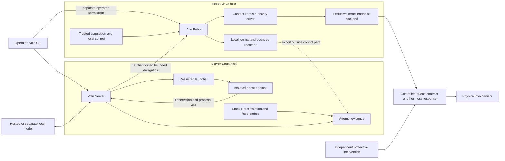
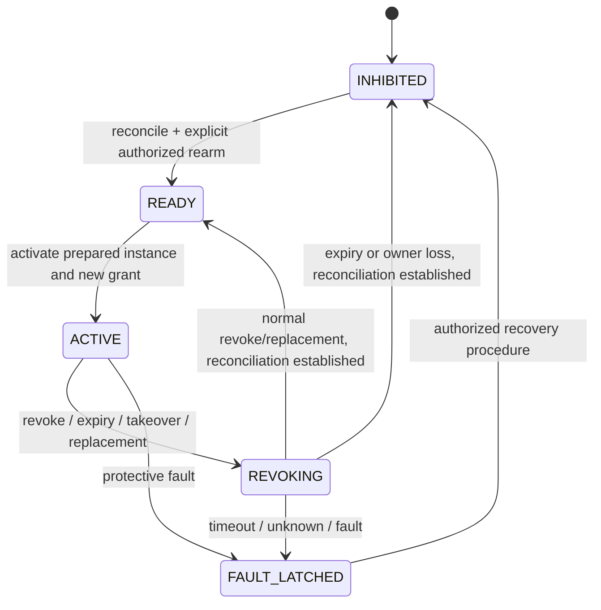

# VolnLabs system architecture and project distribution

Date: 2026-10-13. Status: **proposed design for review**, not an implemented or qualified system. Names, commands and repository trees below are proposed interfaces. No hardware configuration, commercial dependency, performance bound or customer demand is established by this document.

## 1. Recommendation and design brief

Build **Voln Server** and **Voln Robot** around one operator CLI and a shared contract. Keep userspace cohesive, release a small custom Linux authority component separately, and distribute hardware support as versioned target packages. Keep AxiomOS as a source of implementation experience and regression cases; extract its authority and lifecycle logic without bringing its boot, memory, filesystem or scheduler stack into the product.

The product is a repeatable operation: install, pair, observe, propose, admit, execute locally, interrupt, reconcile, rearm, inspect. Server-only installations must also be useful: a team can run an isolated agent attempt and explain its Linux resource consumption and denied operations without owning a robot.

User requirements carried into this design:

- Execution and authority remain local to the robot; model inference may be remote.
- Generated applications cannot obtain raw actuator access or enlarge their own grant.
- Installation works on an existing supported Linux distribution.
- Replacement, retries, crashes, controller queues and physical uncertainty are explicit parts of the contract.
- Upstream projects are assessed for a specific capability; adopting an entire framework is not the default.
- The first supported physical configuration and recurring customer workflow remain narrow.

Working assumptions: one commercial robot-learning/agent team as the buyer hypothesis; one operator-managed site; one controller ownership group; a restrained fixture before an assembled rover; a hosted model for the first demonstration. These are recommended starting choices, not confirmed equipment or measured inference suitability. TurtleBot3/OpenCR is not selected.

**Confirmed user decision:** a custom Linux kernel component is mandatory in the first release. The design retains the kernel/userspace direction in the older [context brief](../../../../docs/proposals/axiomos-context-2026-10-11.md), with a concrete initial mechanism: a small authority driver and one exclusive controller transport backend. The component governs ownership, dispatch and handoff; it does not run arbitrary agent code. Kernel inclusion is a product requirement, while superiority over the userspace baseline remains a hypothesis to measure.

### Alternatives considered

| Approach | What it buys | Cost / reason for decision |
|---|---|---|
| **Selected: our kernel authority component plus Linux userspace services** | One kernel-owned publication/dispatch boundary, existing Linux installation, separable server product | Requires exact kernel builds and a narrow supported transport; privileged Linux and downstream controller remain trusted |
| Userspace authority gateway on stock Linux | Smaller maintenance surface and a strong comparison baseline | Does not satisfy the required kernel component; retain as a measured baseline and reference model |
| Build a distribution around a complete upstream robotics/agent platform | Faster access to that platform's integrated features | Imports its authority, lifecycle, dependency and update assumptions; adapt only if its semantics fit better than our small core |

Do not fork a dependency merely to call it ours. Our ownership comes from the interfaces, integration, guarantees, support and evidence we maintain. A proven library may remain an ordinary pinned dependency; source extraction needs an explicit advantage over using its public API.

## 2. Product and repository boundaries

Start with **three product repositories**, plus the existing research/reference repositories. Kernel and firmware qualification have different compatibility obligations from userspace. Processes and libraries do not each need their own repository.

| Repository | Contents | Release / owner responsibility |
|---|---|---|
| `volnlabs/voln` | CLI, server, robot manager, Linux probes, RPC contracts, Python SDK, userspace reference model, packaging and cross-boundary conformance tests | One tested userspace release; runtime/platform owner maintains client compatibility and security fixes |
| `volnlabs/voln-linux` | Small authority driver, first kernel endpoint backend, versioned UAPI, kernel selftests, build/configuration and packaging metadata | Kernel owner maintains exact supported bases, synchronization, ABI, module provenance and security fixes |
| `volnlabs/voln-targets` | Exact target manifests, electrical/setup documents, calibration procedure, controller firmware we actually maintain, target-specific fault/physical qualification procedures | Independently versioned target package; endpoint owner signs off supported combinations and changed physical claims |
| Existing `axiomos` | Bare-metal research and source from which tested state machines are extracted | Separate research release; not a transitive production dependency |
| Existing/reference `linux` and `ref/*` | Source inspection and bounded experiments | Not shipped, built or updated implicitly by product builds |

Do not create a server kernel fork and a robot kernel fork. `voln-linux` is initially a small source repository for a driver built against named distribution kernels, not a copy of the entire Linux tree. Prefer a loadable module using exported interfaces; maintain a minimal patch series only where an exact supported target needs it. The server uses stock kernel isolation plus our packaged BPF programs; the robot installs the authority driver. Every production kernel build remains pinned and qualified.

Keep customer recordings, credentials and site-specific evidence outside source repositories. Target packages contain public fixtures and evidence manifests; private raw evidence belongs in access-controlled artifact storage. A qualification statement names its exact software, target and evidence digests.

Proposed `voln` layout (logical boundaries, not a requirement to create one crate per directory):

```text
voln/
  apps/
    cli/                    # voln
    server/                 # voln-serverd
    robot/                  # voln-robotd: preparation, RPC, kernel client
    host/                   # restricted launch helper and observer
  crates/
    contracts/              # stable identity, messages, outcomes; no device I/O
    axiom-model/            # extracted semantic model and userspace baseline
    shrike-wire/            # reference codec/test vectors; no automatic kernel use
  adapters/
    kernel/                 # checked client for the authority UAPI
    ros2/                   # added only for a selected ROS controller profile
  sdk/python/               # generated transport types + small ergonomic client
  schemas/                  # versioned RPC and event definitions
  bpf/                      # reviewed fixed probes and optional denial programs
  packaging/{deb,systemd}/
  tests/{contract,fault,compatibility}/
  docs/{architecture,operator,integrator}/
  third_party/              # notices, extraction provenance and patch records
```

Proposed `voln-targets` layout:

```text
voln-targets/
  targets/<target-id>/<revision>/
    manifest.yaml           # hardware + complete compatible software tuple
    command-paths.md         # every route to the protected outputs
    endpoint-contract.yaml  # machine-readable supported subset
    wiring/                 # actual protective mechanisms and instruments
    qualification/          # procedures, fixtures, acceptance definitions
  firmware/shrike/           # only if we own firmware for that target
  evidence-manifests/        # hashes/references; no implied physical PASS
```

Dependency direction: RPC contracts → userspace services/SDK; versioned kernel UAPI → checked userspace kernel client. The kernel driver has no dependency on Python, RPC libraries or daemon internals. Target packages pin product, kernel component and firmware versions; the product does not import arbitrary scripts from target manifests. Share a portable wire library with firmware only if its actual allocation/platform constraints fit; otherwise use golden protocol vectors across implementations.

Proposed `voln-linux` layout:

```text
voln-linux/
  include/uapi/linux/voln.h  # canonical versioned kernel interface
  drivers/voln/
    authority.c             # ownership, publication, queues, revocation
    limits.c                # fixed first-endpoint validation
    shrike_serdev.c          # sole UART writer + bounded protocol handling
  tests/{kunit,selftests}/
  compatibility/            # golden traces shared with the userspace model
  packaging/                # exact kernel tuples, module signing, build metadata
  patches/                  # only when a supported base requires a patch
```

Keep RPC schemas, SDK and daemons together so API changes are reviewed together. Kernel UAPI is canonical in `voln-linux`; userspace consumes its versioned header/bindings and CI detects drift. Wire vectors are versioned shared artifacts, not a circular source dependency. Target manifests pin both releases and firmware. Kernel-internal Linux APIs are not assumed stable between builds.

## 3. Deployment topology and trust



First demonstration topology: a server laptop or separate supported Linux host, robot-local computer, and the selected controller/fixture. A second Pi can serve as the server if its measured workload fits; exactly two Pis is not a product requirement. Hosted inference leaves agent orchestration local but **does not make inference local**. No hosted model is required for cancellation, revocation, controller fallback or rearm checks.

Permit a single-machine developer/simulator profile, with no live actuator device mappings. Co-locating inference and motion on a physical robot is a separate resource-interference qualification, not a packaging checkbox. Do not initially support mutually hostile tenants on a robot; each robot runtime owns one site configuration and explicit coupled actuator groups.

### Processes and privileges

| Process / component | Responsibility | Authority |
|---|---|---|
| `voln` | Human/automation client, diagnosis and offline evidence inspection | User credential scope only; no hidden motion or deployment privilege |
| `voln-serverd` | Attempt orchestration, model/tool correlation, scoped robot client, evidence index | No raw devices, BPF loading or unrestricted container-engine socket |
| Restricted host helper | Server launch or robot operator administration, in separately scoped service roles | Protected authenticated local interface; caller-to-attempt/policy authorization; no caller-selected ownership, arbitrary descriptors, host command or credential paths |
| `voln-observer` | Attach/read approved Linux probes; emit attribution and loss records | Profile-specific loading privileges; agent cannot submit BPF or access writable maps |
| Agent attempt | Run Python/native tools/model client | Its sandbox and bounded proposal channel only |
| `voln-robotd` | Robot RPC, authentication, artifact preparation, durable intents, kernel requests, evidence export | Runtime kernel handle within installed ceilings; no raw controller access and no ability to forge a kernel handoff receipt |
| `voln_authority.ko` + selected backend | Sole effective ownership, grant generations, fixed validation, publication, transmit queue and controller protocol | Kernel-resident final host dispatch boundary; direct controller binding excludes normal userspace writers |
| Sensor/control component | Produce qualified observations or execute a local policy | Narrow read/data interfaces; any command output still traverses the gate |
| Controller / protective equipment | Declared downstream execution, expiry and host-loss behavior | Independent of server and host application progress where the profile requires it |

The robot daemon handles management, preparation and persistence in userspace; it does not own a competing grant table. The kernel owns the effective grant and serialized dispatch state. A selected kernel backend binds the first controller transport. A future vendor/ROS worker can only offer the same enforcement claim if its path passes a suitable kernel endpoint integration; otherwise it is a separately labelled userspace-adapter profile, outside the first kernel-enforced motion claim. A worker holding raw actuator access remains trusted, even in another process.

The V1 threat model includes hostile unprivileged agents, delayed/replayed requests and component crashes. It trusts the host kernel, administrator, launcher, authority daemon, adapter, controller and required sensors. A kernel extension would not by itself protect against a compromised kernel or root administrator. A later hostile-host profile needs an independent authenticated enforcing controller/domain with suitable observation provenance; do not sell it as an automatic benefit of eBPF.

## 4. A small kernel authority component, not a new operating system

Use a supported distribution kernel, systemd and cgroup v2. Start with a single qualified distribution family and exact server/robot kernel configurations; different board kernels are acceptable. First package targets are Linux x86-64 server and AArch64 robot, subject to target preflight. Kernel/configuration version strings are filled by qualification, not invented in this design.

| Concern | Initial mechanism | Boundary / failure rule |
|---|---|---|
| Files, credentials, processes, devices | Namespaces, mount allowlist, UID separation, dropped capabilities, seccomp, device policy | Verify the installed policy before starting untrusted code; deny raw controller, GPIO, bus, runtime socket and inherited handles |
| CPU, memory, I/O, task counts | cgroup v2 profiles; bounded application queues | Constrains consumption; does not prove robot deadlines |
| Server network access | Dedicated sandbox network policy and explicit model/tool egress | Deny the agent's controller/alternate-service access; target/site network policy separately closes routes from other hosts |
| Attribution | Trusted launcher records attempt before execution; cgroup/process lifecycle tracking | Never trust an agent-provided PID, cgroup or trace ID as authority |
| Required host denial | Existing kernel mechanisms; selected supported BPF LSM hooks only where needed | Attach/verification failure prevents that policy-dependent workload from starting |
| Diagnostic visibility | Counters/pressure first, then a small libbpf CO-RE probe set | Missing probes or dropped records mark coverage incomplete; no silent prevention claim |
| Typed motion limits, ownership, stale requests | Custom `voln_authority` driver at its supported endpoint dispatch boundary | Generic BPF hooks do not supply these semantics; no coverage claim for unrelated drivers |
| Host freeze / loss of power | Named controller/protective mechanism | Cannot depend on another process on the same frozen Linux host |

The kernel's [cgroup documentation](https://docs.kernel.org/admin-guide/cgroup-v2.html), [BPF LSM documentation](https://docs.kernel.org/bpf/prog_lsm.html) and [libbpf overview](https://docs.kernel.org/bpf/libbpf/libbpf_overview.html) support the separation between resource/access mechanisms and observation. CO-RE reduces dependence on kernel structure layouts; it does not guarantee available hooks or semantic compatibility.

Ship `bpf/` objects and a feature manifest as ordinary product artifacts. Fixed reviewed C BPF programs with a libbpf-based Rust userspace loader are the initial observation direction. Required denial links/policies outlive the diagnostic reader through protected ownership/pinning. Loss of required enforcement blocks new launches and applies the declared quarantine/termination policy to affected attempts; it cannot undo an earlier effect. Reader loss marks evidence incomplete and never relaxes denial. Each product profile identifies its required enforcement and denied-operation reporting sources and versions.

### Kernel responsibilities and UAPI

The first driver provides a **fixed typed command class for one wheel-pair/fixture endpoint**, not a universal robotics syscall. It owns endpoint state, immutable owner-policy ceilings, active instance/grant generation, robot-local expiry, the bounded queue, final validation, revocation, controller session/barrier state and the authoritative event sequence. Only controller facts parsed by its backend can complete handoff. It must not accept a userspace `safe=true` assertion as that fact.

Use a small character-device UAPI with separate administrator and runtime descriptor rights. Illustrative operations are `GET_CAPS`, `CONFIGURE_INHIBITED`, `REGISTER_INSTANCE`, `PREPARE_TRANSITION`, `ACTIVATE`, `SUBMIT`, `REVOKE`, `QUERY`, `REARM` and read-only events. Operator configuration/rearm require the separate admin role; runtime requests cannot widen ceilings or clear stop latches. A returned grant handle is bound to the registered runtime session and restricted descriptor rights. Direct local callers also require credential/descriptor ownership checks; a passed FD is not unlimited delegation. Remote identity is authenticated by the trusted robot manager, not discovered by the kernel from a claimed model hash.

The admin role creates the pending grant under its installed policy. Runtime `ACTIVATE` and `SUBMIT` only consume that operator-authorized grant; they cannot mint or enlarge authority, even below global ceilings. The grant binds the permitted principal/instance, group, operation class, duration and limits. Normal replacement needs an authorized candidate grant in addition to a successful handoff.

Use fixed-width fields, explicit lengths/versions, initialized padding, checked arithmetic and bounded copies; no userspace pointers survive a call, no borrowed userspace memory drives output, and no kernel pointers escape in events. Unknown mandatory operations/features fail. Session-owner death or closure revokes its task authority; descriptor duplication/inheritance must not prolong that owner's registered lifetime. Finite expiry also covers a live but stalled daemon. Module reload and daemon reconnect create fresh nonrepeating session epochs. The exact task-reference/death-notification mechanism requires implementation review against the selected kernel; it cannot rely only on the last duplicated FD closing.

### First enforceable transport

The architecture candidate is a **dedicated UART bound through Linux serdev to the custom Shrike backend**. This is a proposed fixture connection, not confirmation of available Pi pins, wiring or deployed firmware. Successful serdev binding must exclude a normal writable TTY; the target also disables competing console/debug/boot-time use and audits pinmux, raw MMIO, debug/flashing and alternate controller routes. A binding failure must keep motion inhibited even if Linux falls back to exposing a TTY. A USB serial controller is not automatically a serdev endpoint and would need a separately designed backend.

All first-profile output writes originate in that backend. The enforceable boundary is **acceptance into the underlying UART driver's buffer**, not the moment the last physical bit leaves the pin. Use the nonblocking buffer-write interface, account for short/zero acceptance, serialize each accepted prefix with revocation, and track partial frames. Recheck current authorization before continuing output; after revoke, only the protocol's explicitly authorized abort/completion/resynchronization path may finish a started frame. An in-kernel gate cannot retract bytes already buffered downstream. Buffer flush/drain is not controller acknowledgement or cancellation proof.

The initial language choice is **C for the narrow kernel driver**, Rust for userspace and the extracted reference model. This fits ordinary kernel integration and avoids making Rust-for-Linux availability a requirement of the first target. The inspected Linux tree does contain Rust serdev support; C is a proposed support/maintenance choice, not a claim that Rust is impossible. Carry golden frame vectors, state-transition traces, fuzz cases and differential checks across the implementations. Never link the existing bare-metal Rust crate into Linux just because it is `no_std`.

A dedicated bounded worker owns authority/transmit transitions; receive and write-wakeup callbacks do bounded capture/scheduling in their permitted contexts. Exact lock order, callback lifetime, timer/work cancellation and disconnect handling are kernel review obligations. No filesystem/network/model work or unbounded controller wait occurs under the authority lock. Preallocate bounded queues; reserve revocation capacity; faults in allocation, timer progress or transport cause the defined inhibition. Suspend, unbind, shutdown and unload require quiescence/authority invalidation. Physical disconnect can prevent a stop message, so independent controller expiry remains essential. The [source review](../../research/2026-10-13-source-review.md) records the inspected serdev APIs and limits.

### What does not enter the kernel

Python, LLM inference, perception, motion planning, arbitrary policy graphs, artifact downloads/signature parsing and database writes stay in userspace. The kernel trusts its authorized manager's registration of executable provenance; this is weaker than verifying and executing the behavior bytecode itself in AxiomOS. It still independently enforces the installed command envelope, generations and endpoint protocol. The first release makes no claim that it runs AxiomOS managed programs or preserves their resource accounting.

No new JIT, scheduler, universal protocol parser or custom BPF verifier is selected. V1 fixed predicates cover numeric/identity/freshness limits. Replaceable admission predicates are a later bounded extension with a separately specified hook/context and verifier; they cannot widen fixed ceilings, alter owner transitions or clear latches. The custom driver is meaningful even without programmable predicates.

Measure the kernel component against the competent userspace baseline on the same endpoint. Its proposed benefit is enforceable single ownership at the supported host transport and a kernel-resident lifecycle when a userspace client misbehaves or exits. Kernel placement alone does not prove improved latency, resistance to kernel compromise, or physical safety.

## 5. The independent server product

Choose one initial sandbox backend: **OCI containers through containerd**, mediated by the restricted launcher. Reuse the runtime, not its unrestricted management API. A microVM backend is a later decision for a stronger stated threat model; Wasm is a different workload class. Wendy must not create a second independent sandbox lifecycle if its deployment integration is adopted.

The launcher creates `tenant → job → attempt → sandbox` records, allocates the cgroup and policy, prepares the workload without running application code, registers attribution and checks required enforcement, then releases execution. If the chosen runtime cannot provide that ordering, the launch integration fails acceptance. Fork/exec descendants inherit the attempt association; migration outside the designated cgroup is denied. Process identity includes host boot/lifetime information, not PID alone. Cgroup IDs and paths are also scoped to their lifetime. Cleanup includes descendants and credential revocation.

Start with process lifecycle, CPU/memory/pressure, I/O and network metadata. Correlate explicit model and tool spans through our client/broker. Add scheduling/page-fault probes only to answer a specific diagnosis question. Shared inference workers retain explicit request spans; a host cgroup cannot attribute every shared GPU operation to an individual request. A microVM appears as host VM activity unless an independently trusted guest collector supplies finer evidence.

Expose a report such as: attempt X exceeded its memory budget; subprocess Y made a denied device-open request; inference request Z overlapped I/O pressure. Preserve unknowns, probe loss and clock uncertainty. Do not infer plaintext model activity from encrypted sockets or equate network events with completed tool effects.

Provider credentials belong to a scoped broker or per-attempt credential delivery mechanism. Do not mount site credentials or expose the robot administrator key. Default evidence stores metadata, not full prompts, sensor images or secret-bearing syscall payloads; content capture is an explicit site policy with access/retention controls.

A server-only release exits when isolation, attribution, denied-operation reporting, resource-pressure diagnosis, cleanup and evidence export work without a robot. It need not wait for motion qualification.

## 6. The robot execution contract

### Objects, identity and API

| Object | Meaning |
|---|---|
| Artifact | Immutable code/configuration identity and compatibility requirements; installation grants no authority |
| Instance | Fresh running attempt at that artifact, with separately owned mutable state |
| Owner policy | Operator-installed immutable revision of the allowed envelope and recovery conditions |
| Grant | Robot-issued, principal/instance/group-scoped permission with local expiry and generation |
| Operation | Stable externally meaningful requested effect, with digest and durable identity |
| Proposal | Typed request referencing the operation, current grant and required observations |
| Observation record | Robot-retained provenance, acquisition/receipt times, calibration and validity |
| Outcome | Separate admission, delivery, reconciliation and physical-evidence facts |

Use a versioned Protocol Buffers RPC schema for management and proposal traffic over authenticated TLS; local administrative access uses a protected Unix socket with peer identity checks. The initial Python SDK and CLI are thin clients of the same API. Use an established RPC/crypto implementation, not a bespoke transport. Bulk images use a separate bounded channel/object reference; no high-rate image stream shares the dispatch queue. Controller serial/CAN framing remains endpoint-specific.

The robot binds the authenticated peer to its local principal and grant; a request's identity fields are not proof. A compromised server can act within its delegated bounds, so the robot's policy cannot depend on the server being honest about model intent. Device pairing, software deployment, grant issuance and rearm are separate scopes. A renewal cannot revive an expired/revoked grant or clear a stop latch. Loss/revocation of a paired credential must take effect locally according to a finite delegation lifetime even during disconnection.

A proposal names schema version, operation ID, payload digest, instance, endpoint group, robot runtime epoch, grant generation, sequence, requested action/mode/units/frames, relevant observation IDs and a requested horizon. The robot supplies actual deadlines from its own clocks and retained context. Reject unknown required fields/features, nonfinite values, overflow, incorrect joint ordering/masks/frames, incompatible configuration and excessive payload/queue sizes. Server wall-clock timestamps are diagnostic only.

One scalar owner is insufficient for coupled robots: a profile declares which actuators form an indivisible arbitration group and how the local controller arbitrates task targets, stabilization and protective commands. Only one final dispatcher commands each protected output. High-level task authority supplies bounded targets to the stabilizer; it does not compete with the stabilizer as another raw motor writer. Protective authority can inhibit or replace the task target under fixed rules.

### Observation validity and timing

Sensor records distinguish acquisition from host receipt. If sensor time is not directly in the robot clock domain, retain a qualified clock mapping and its error bound. If acquisition age cannot be bounded, mark it unknown and deny operations requiring bounded acquisition age; a recent USB receipt does not repair an old buffered image. Calibration changes invalidate dependent observations.

The trusted acquisition bridge registers a small bounded context through a separately authorized kernel interface: source/observation ID, acquisition-time bound, clock/calibration revisions and typed state needed for the fixed gate. The kernel copies and validates that context, records its receipt time and checks required age/version at dispatch. It does not parse camera images or independently prove a sensor's timestamp. That bridge and its clock mapping remain trusted; an agent cannot register replacement observations or refresh an old record by reusing its ID. The large observation payload/cache stays in userspace.

Use a robot clock contract that accounts for suspend; the physical profile disables suspend and treats a detected discontinuity/resume as inhibition and reconciliation. Do not let a stopped monotonic clock extend authority across suspend. Observation cache misses, overwritten records, stale local state and invalid confidence fail the relevant precondition. Model-generated world descriptions remain estimates, not trusted sensor assertions.

Separate five horizons: observation validity, agent computation, admitted skill duration, authorized dispatch horizon and downstream accepted work. Under the brief's illustrative 10–50 ms RTT, a round trip alone spans 5–50 periods at 500–1000 Hz. That calculation motivates local control; it is not a measured network profile or a promise that the robot daemon runs at those frequencies.

### One authoritative mutation order

The extracted Rust `axiom-model` is a deterministic reference for authority/lifecycle decisions. The production kernel implementation owns the same defined transitions but must establish Linux synchronization and lifetime guarantees independently. The model never sends output and is not a second live authority. Differential tests compare transitions and event meanings, not just final boolean results.

The kernel dispatch lane alone mutates the effective grant, generation, publication state and transmit queue. Management syscalls submit bounded events. Admission checks and queue insertion are one ordered transition. At each downstream buffer-acceptance boundary, recheck authority, local expiry and required state subject to the partial-frame recovery contract. Revocation is ordered against that transition; no independent adapter writer exists.

Never hold this execution lane waiting for network, fsync, model inference or controller acknowledgement. Completion callbacks carry operation, session and generation identities and are ignored as state-changing inputs after their transaction terminates. Reserve bounded capacity for revocation/protective events so agent saturation cannot fill their lane; protection still depends on the independent endpoint when the host cannot progress.

An output stream is not transactional. Track `UNSENT`, `TRANSMISSION_STARTED`, `LOCALLY_WRITTEN`, and the endpoint's actual acceptance/reconciliation facts. Drop unsent frames on revoke. Finish, abort or resynchronize a partially transmitted frame only as its protocol permits; account for any effect it may still cause. A local write completion proves neither controller acceptance nor physical response.

### Lifecycle



Candidate preparation is orthogonal to this state machine. Prepare/validate/allocate B while A operates; B has no grant. A failed preparation leaves A alone. For replacement, name the expected generation and policy revision; close A's admission; reconcile its downstream work; then publish B with fresh state and a new generation. A normal pre-authorized replacement may activate after a proven handoff. Any expired, unknown or fault-latched transition requires its explicit recovery/rearm path. A timed-out transition cannot later publish B on a delayed receipt.

V1 state policy is **fresh state on activation**, including selecting a previously used artifact. No arbitrary state migration, transparent CRIU restoration or physical rollback. Restoring a process cannot restore a robot session or grant. Robot daemon restart creates a fresh runtime epoch even within the same OS boot; controller restart changes the endpoint session and inhibits its group. Neither automatically resumes motion.

Operation IDs are allocated by the robot under a kernel-issued nonrepeating runtime epoch. The client supplies a stable proposal request key within its attempt; the robot durably binds that key, operation identity and payload digest before first possible dispatch. Same ID/same digest returns the known state; same ID/different digest is rejected. After restart, **every unfinished durable operation is conservatively `OUTCOME_UNKNOWN`**, even when it might never have dispatched, until reconciliation establishes more. Never automatically resend it. Known old IDs remain queryable; retired epochs cannot create new effects, even after result compaction. The SDK never changes epoch or request key to turn a retry into a fresh action. This is not an exactly-once physical-effect guarantee.

Persist the operation intent in the preparation path, then send a ready-to-dispatch event to the execution lane and recheck all live conditions. Do not fsync every servo sample. Continuous samples belong to a bounded admitted operation and retain their own sequence/age rules; losing their evidence tail is explicitly possible.

## 7. Endpoint support is a qualified contract

Select the first physical endpoint by its enforceable route and recoverability, not its popularity. A Shrike-derived restrained motor fixture is the first engineering candidate because source exists; exact board, electrical response, motor/driver, instruments and firmware remain unselected. No physical result is claimed.

Every target package must declare:

1. Exact hardware, controller firmware, host/kernel configuration, cooling/power, payload/calibration and independent protective mechanism.
2. All actuation routes: device nodes, sockets, network services, raw buses, shared memory, inherited descriptors, debug/flashing interfaces and controller-local autonomous modes.
3. Final reject/dispatch point, all trusted code after it, every downstream queue and its bound.
4. Supported typed commands and intentionally unsupported modes, limits, units, frames, coupling and timing inputs.
5. Cancellation, barrier, acknowledgement and expiry meanings; whether a receipt proves parsing, queue removal, controller state, or something physically measured.
6. Agent-loss, daemon-loss, host-loss and controller-restart behavior, including distinct braking, holding, torque-disable and power-removal semantics.
7. Recovery/rearm preconditions and the independent observation needed to claim takeover complete.
8. Exact tests and required measured limits for this version; omitted critical limits make a physical profile invalid.

A controller watchdog refreshed by any arriving byte may be kept alive by obsolete queued traffic. Qualification must address this. Prefer session-bound controller validity/expiry with an endpoint clock contract; otherwise bound and test the complete buffered-traffic plus watchdog response. A host timestamp or a controller TTL that starts only when a delayed command arrives is not automatically enough. Do not assume the current Shrike firmware already implements every required mechanism.

For ROS 2, leaving `/cmd_vel`, controller-manager switching, a vendor service or direct bus access reachable can bypass the product. Protect the entire actual path, including commands from other hosts. A ROS adapter is supported only when those routes and downstream queues are closed or explicitly trusted. ROS graph membership and successful message delivery are not authority.

The local controller continues an admitted skill only for its declared bound, or switches to its declared fallback. Stabilization/protection does not disappear because experiment authority expires. A human takeover also uses the ownership/handoff rules; an operator command-line stop request is never represented as an independent physical emergency stop.

## 8. Evidence, persistence and inspection

Use **SQLite** for local operational metadata/intent/result indexing and **MCAP** for timestamped event/sensor recordings. Keep them on bounded separate write paths from dispatch. A recording format supplies records and indexes, not proof of physical completion; see the [MCAP specification](https://mcap.dev/spec). Export OpenTelemetry spans for application/host correlation and integrate a viewer such as Rerun only through a read-only exporter.

Each authoritative event contains producer identity and lifetime, monotonically increasing producer sequence, local time/clock domain, contract/configuration identities, attempt/operation/observation references, and its precise evidence class. Correlation IDs connect records; the originating trusted component supplies each fact. Agents may append their explanations, but cannot overwrite admission, controller or measured outcomes.

Kernel admission/publication/dispatch events are read from a bounded kernel event stream and persisted by the robot manager. Sequence loss and producer/session changes remain visible through export; manager-authored events cannot substitute for missing kernel events. The kernel tracks reader acknowledgement/health under a bounded evidence policy: if required recording cannot keep up or the manager dies, it closes new experiment admission and follows the declared revoke/fallback contract. Acknowledged readout is not durable storage; unfinished durable intents still become unknown after a crash. Protection never waits for evidence persistence.

Keep admission (`allowed`, `clamped`, `rejected`), delivery (unsent/partial/controller accepted), lifecycle (revoked/reconciled/unknown) and physical evidence (observed/unconfirmed) as separate dimensions. A clamp reports both requested and admitted values. A controller receipt can coexist with `physically_unconfirmed`. Model success is a separately recorded task-evaluation claim.

Critical operation intents become durable before dispatch, outside the dispatch lane. Subsequent records are sequenced and asynchronously persisted; a memory enqueue is not a durable acknowledgement. Recorder health gates new experimental admissions. On critical backlog exhaustion, close new admission and perform the profile's bounded continuation/fallback; reserve capacity for essential fault/transition records. Stop/protective actions never wait for a healthy recorder. Sensor/diagnostic loss emits gap/counter records; a crash can lose the final gap event, so producer restarts and unfinished durable operations also mark incomplete evidence. Do not promise zero-loss logging through power loss.

Replay uses recorded observations and model outputs with a simulator/no-device adapter. Run it under an identity without live keys, actuator access or a path to the robot command service. A `--replay` boolean is not the isolation boundary. Exports retain intervention, clamping, stale rejection and uncertainty; dataset labels never silently substitute proposed motion for executed motion.

Initial UI: CLI plus a generated attempt report/timeline and an existing viewer. Build a cockpit only after operators repeatedly need a workflow those surfaces cannot support. Do not build a trace database, plotting system and fleet dashboard in V1.

## 9. CLI, SDK and distribution

One `voln` command, task-oriented nouns, structured `--json` output, stable reason codes and actionable operator messages. The following illustrates the proposed surface; these commands do not exist yet:

```text
voln doctor --role server
voln doctor --role robot --target <target-package>
voln device pair <robot> --scope propose,observe
voln robot describe <robot>
voln bundle inspect <bundle>
voln bundle install <bundle> --robot <robot>
voln instance prepare <artifact> --robot <robot>
voln grant issue --robot <robot> --instance <id> --policy <policy>
voln robot rearm <robot> --expected-generation <generation>
voln instance activate <id> --expected-generation <generation>
voln attempt run <agent-bundle> --grant <grant>
voln operation inspect <operation-id>
voln operation cancel <operation-id>
voln robot reconcile <robot>
voln attempt inspect <attempt-id>
voln evidence export <attempt-id> --output <directory>
voln replay <recording> --target simulator
```

`grant issue` creates only a pending bounded grant for the prepared instance; it becomes effective only through eligible activation. `rearm` is an explicitly authorized operator operation after local recovery checks; it does not activate a prepared behavior. Grant issuance, rearm and activation are not exposed to an ordinary experiment agent. Installation does not arm. `cancel` returns requested/locally-revoked/reconciled states as they become known; timeout is not success. Machine-readable outputs include the authoritative generation for race-aware operator actions. Local inhibit/recovery remains available when the server is down.

The Python API initially needs describe, observe, propose, query and cancel, with typed inputs and structured outcomes. It does not mirror the entire administrator API or expose raw register writes. RAI or another agent framework integrates as a client of this API only after a concrete application warrants it.

### Packages

| Artifact | Installation / updates |
|---|---|
| `voln-cli` | Versioned native Linux CLI package/archive; no daemon needed for offline evidence inspection |
| `voln-server` | Signed distro package, server/helper units and one supported OCI backend configuration |
| `voln-robot` | Signed distro package with native manager and checked kernel client; requires compatible authority component and starts inhibited |
| `voln-kmod-<kernel-build>` | Signed authority module/backend for an exact supported kernel/configuration/architecture; optional device-tree overlay belongs to the target package |
| `voln-observer` | Separately installable fixed probes/loader; required only by a selected policy/diagnostic profile |
| Python `voln` SDK | Versioned wheel, schema compatibility tested against product release |
| Agent bundle | Immutable OCI image digest plus manifest; model/framework dependencies stay here |
| Target package | Signed declarative manifest, approved controller artifacts and qualification references |

Choose Debian-family packaging first, subject to confirming the first target distribution. Do not promise every Linux distribution or desktop OS. Native robot services and the kernel backend simplify controller ownership; agent applications use OCI containers. An offline install bundle contains required packages/images/modules, notices and checksums. Installation verifies provenance, compatibility and storage availability; it never runs unreviewed target-package shell hooks. Module signing/Secure Boot integration follows the selected distribution's trust policy. An unsupported kernel update inhibits motion until its matching component and target profile are qualified; silent DKMS recompilation is not qualification. Preserve an inhibited recovery boot path.

Use one product release train and explicit component versions. Compatibility is a tuple of RPC major/features, core version, endpoint-contract version, adapter, firmware/protocol, owner-policy/configuration, calibration, kernel/configuration and hardware revision. Unknown required capabilities block activation. Support old/new combinations only where the compatibility suite and target package name them.

Application deployment, behavior activation and trusted-stack upgrade are separate operations. Trusted-stack upgrade requires inhibited state, downstream reconciliation, compatible staged artifacts and recovery access; failed installation remains inhibited. Test recovery for interrupted firmware updates using that controller's actual mechanism. A software rollback never rolls back motion or resurrects grants. Image OTA/RAUC and full WendyOS integration remain optional delivery backends.

Preserve immutable attempt/configuration records before database migration. Use backward-readable evidence or an explicit versioned offline converter. Operator data retention and export precede destructive migration/uninstallation; never hide deletion in an update.

Publish versioned interface documentation, SDKs and conformance examples so integrations do not require founder assistance. Keep customer credentials/configuration and private recordings out of public releases. Select source licenses per shipped component and inherited obligations; the kernel module uses GPL-compatible interfaces, while the commercial boundary can be supported profiles, integration, updates and qualification. This document does not settle licensing for all original userspace code.

## 10. Reuse policy and AxiomOS extraction

For each candidate, name the problem, exact imported unit/API, assumptions we retain, semantics we change, license/provenance, patch owner, replacement route and acceptance test. Classify the outcome as **ordinary dependency**, **adapted source**, **external integration**, **reference**, or **defer**. A top-level repository license is not a complete binary dependency inventory.

Recommended starting stack: Rust native services/CLI and semantic reference model; a narrow GPL-compatible C kernel authority driver with one serdev backend; small Python SDK/client; supported Linux/systemd/containerd; selected fixed libbpf probes; established Protobuf/RPC/TLS implementation; SQLite and MCAP. These are architectural choices, not a claim that the combined stack has been built or tested.

- **AxiomOS:** adapt artifact/instance separation, publication transactions, fixed actuation validation, Shrike framing/handoff and their regression cases. Reimplement synchronization and I/O ownership for Linux. Do not lift kernel globals, CPU-local assumptions or timing claims.
- **Wendy:** evaluate the existing-Linux deployment path as an optional integration. Device pairing/deployment may save work; authority remains ours. Do not import its entire OS, app lifecycle, CLI and update manager as parallel product owners.
- **Copper:** benchmark as a possible local application executor/recording integration behind our contract. It does not own grants. Do not embed Copper plus another execution scheduler by default.
- **AgentSight/Huatuo/Actime/ActPlane:** extract useful probe/attribution/policy integration patterns only when a chosen feature wins against standard counters/tracing. No aggregate observability platform dependency is selected.
- **ros2_control/vendor SDKs:** integrate the actual supported endpoint interface and retain its limitations. No universal robot abstraction or claim that every driver satisfies cancellation.
- **ROSClaw/OpenRAL/AEROS/APYROBO/Spot:** comparison and interface references. Governed actions and receipts are already overlapping ideas; novelty is not established. [ROSClaw's current README](https://github.com/ros-claw/rosclaw) explicitly describes permits, leases, restart generations and receipts, while [Spot's lease documentation](https://dev.bostondynamics.com/docs/concepts/lease_service.html) includes stale-owner behavior that must not silently replace our rearm rules.

The [source review and adoption decisions](../../research/2026-10-13-source-review.md) record inspected revisions and the limits of this review. Remaining research/model/framework candidates in the supplied brief are kept as deferred inputs to a named problem; no training pipeline or full framework is selected by association.

## 11. Delivery gates and comparative evidence

These are architectural acceptance gates, not a task-by-task implementation plan or calendar commitment.

| Gate | Concrete deliverable | Exit evidence |
|---|---|---|
| D0: endpoint and threat contract | Named buyer/workflow hypothesis; one exact target; command-route inventory; threat/expiry/recovery definitions | Reviewed manifest and quantitative acceptance limits; no live actuation while critical fields are unknown |
| D1: kernel contract and source extraction | Portable semantic reference, kernel authority/backend, UAPI, original scenarios and Linux concurrency tests | Differential traces, KUnit/selftests, malformed UAPI, process lifetime, stale/cancel/partial-frame/restart/teardown cases pass on the selected kernel; reference model stays platform-independent |
| D2: independent server | Install, isolated attempt, attribution, denied-action/pressure report, cleanup/export | Real process fault tests, measured probe overhead and loss; no robot dependency |
| D3: complete software sequence | SDK/CLI through robot runtime to deterministic endpoint fixture | Full install-to-rearm flow; delayed old responses never start a new operation; replay has no live path |
| D4: restrained physical fixture | Exact firmware/electrical path under normal and stressed conditions | Raw synchronized physical/control traces for interruption, host/controller restart, queues and protection |
| D5: repeatable deployment | First supported robot workflow, upgrade/recovery rehearsal, second installation | Installation/operator/recovery costs measured; same core reused without customer-specific authority forks |

One initial physical experiment must cover: agent disconnect/delay; stale reply after revocation; competing owner; controller restart; daemon/host restart; partial transmission; retained controller work; CPU/I/O pressure; recorder overflow; bad calibration/stale observation; and failed trusted-stack update. Freeze the configuration and acceptance thresholds before running, and preserve failures.

Measure observation age, admission/dispatch latency, deadline misses, admission-closure time, downstream-reconciliation time, physical response, residual motion/queued work, recovery time, evidence loss and diagnostic overhead separately. Maximum observed time is not WCET. Software, simulation, restrained fixture and mobile-robot qualification remain separate labels.

Compare against a **competent userspace gateway** on the same controller and Linux profile, with normal isolation, typed limits, expiry, cancellation/watchdog and useful logs. Do not make the baseline artificially omit easy protections. Isolate the incremental contribution of kernel ownership/lifecycle, evidence correlation and selected probes. Kernel presence is required, but a test showing no practical gain must be reported honestly and used to shrink its scope; it cannot become a superiority claim.

Commercial measures: successful attempts per hardware-hour, interventions per attempt, installation effort, time to explain a failure, recovery time and second-installation changes. Acceptance includes supported recovery and update behavior, not just a successful motion demo. Buyer demand and willingness to pay still need external validation.

## 12. Coverage and decisions still requiring evidence

| Supplied problem IDs | Design location |
|---|---|
| 1–5: hardware, identity, installation, adapters, updates | §§2–3, 7, 9, gates D0/D4/D5 |
| 6–10: isolation, enforcement, attribution, diagnosis, contention | §§3–5, 8, D2 |
| 11–15: inference placement, tools, provenance, perception, outcomes | §§3, 5–6, 8–9 |
| 16–20: local control, scheduling, chunks, runtime, transport | §§3, 6–7, 10; specialized scheduling/IPC deferred |
| 21–28: authority, validation, bypass, lifecycle, queues, retry, guards | §§4, 6–7, 10–11 |
| 29–31: fallback, host loss, human takeover | §§3, 6–7, D4 |
| 32–36: evidence, replay, datasets, faults, qualification | §§8, 11 |
| 37–40: DX, dependency terms, paid deployment, differentiation | §§2, 9–11 |

The kernel-in-V1 decision is confirmed. Before implementation, select the exact UART/controller endpoint, kernel/configuration, UAPI rights/lifetime mechanism and quantitative response limits. Before physical release, establish every trusted route, controller timing/recovery condition, source/binary license obligation and raw acceptance record. Before adding Wendy/Copper/other platforms, complete their narrow comparative experiment.

Deferred: new OS, general kernel runtime, custom scheduler/JIT, arbitrary in-process plugins, universal hardware API, arbitrary state migration, multi-robot atomic transactions, every inference mode, model training, general humanoid locomotion, speculative zero-copy and GPU/KV scheduling, fleet dashboard. Each has a later entry condition; none is necessary to define the initial contract.

This document completes the proposed system/project design. It does not authorize claims of implemented synchronization, effective denial on a target kernel, controller equivalence, measured physical safety or a production-ready dependency combination.
